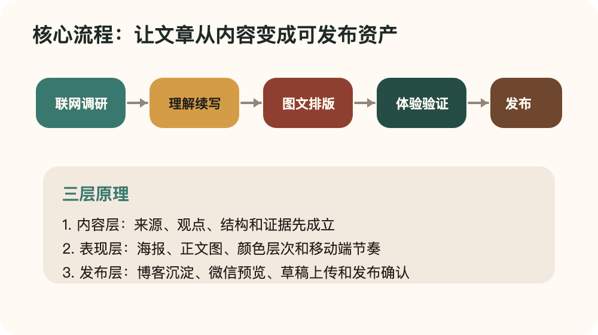
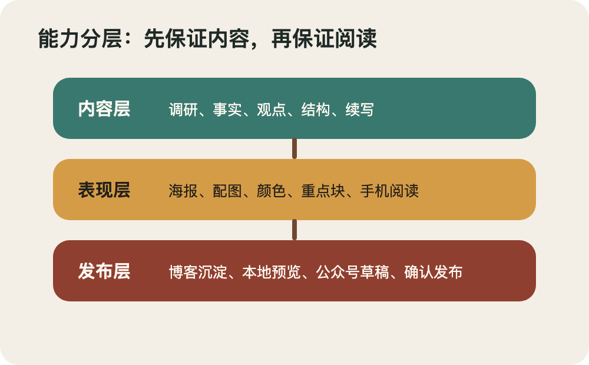

# 这个微信文章工作流，到底解决了什么问题？

> 它不是一个“帮我写篇文章”的模板，而是一条从选题、调研、写作、图文排版、博客沉淀，到公众号草稿的完整生产线。

## 背景：以前的问题不是不会写，而是链路断了

单独生成一篇文章并不难。

真正麻烦的是，公众号文章不是纯文本。它同时需要事实、结构、封面、配图、排版、移动端阅读体验，还要能留存在博客里，最后再进入公众号草稿箱。

过去这几个步骤容易散掉：

- 调研和写作是一段流程。
- 博客正文文档是另一段流程。
- 微信排版又是另一段流程。
- 封面、正文图、素材上传和草稿发布经常临时处理。

结果就是内容本身可能不错，但读者在手机上看到的是一大坨文字。读不下去，文章就等于没有完成。

## 核心流程：先把内容变成资产，再考虑发布

这个工作流现在的流程被拆成六步。

### 1. 调研

如果主题涉及新闻、产品、工具接口、价格、政策、版本变化，就先联网查资料。

它要求保留来源，不允许凭感觉编事实、编数据、编截图。

### 2. 理解

写之前先判断这篇文章到底要讲什么：

- 核心观点是什么？
- 读者为什么要看？
- 哪些信息应该删掉？
- 哪些地方需要图、截图或流程图？
- 适合教程、分析、观点、清单，还是案例复盘？

这一步的作用，是避免文章变成资料拼贴。

### 3. 写作

正文输出的是博客友好的文档。

它必须保留标题、分类、标签、封面、来源和正文图片。也就是说，这份正文文档不只是给公众号用，也能沉淀到本地博客里。

### 4. 图文排版

公众号排版优先交给本地排版流程。

它负责预览、转换、主题、微信网页、素材和草稿相关能力。当前工作流则负责决定文章结构、主题方向和是否允许产生远程副作用。

### 5. 阅读体验验证

这是这次升级最关键的地方。

文章必须有封面/海报、正文配图、视觉断点、颜色层次和移动端可读性。否则不能算完成。

### 6. 发布

默认只生成本地草稿和预览。

只有明确要求“上传草稿”，才会创建公众号草稿。只有明确说“确认发布”或“直接发布”，才会进入发布动作。

## 原理：三层分工，而不是一个脚本包打天下

这个工作流的设计不是把所有事情都自己重写一遍，而是做分工。

**第一层：内容层。**

负责调研、理解、续写、结构和事实边界。

**第二层：表现层。**

负责海报、配图、图文节奏、颜色层次和高流量公众号常见的阅读路径。

**第三层：发布层。**

负责本地博客、本地网页、公众号预览、草稿上传和发布确认。

这样做的好处是，每一层都能被验证。

不是“看起来差不多”，而是可以检查：有没有封面、有没有图、有没有网页预览、有没有颜色层次、有没有草稿风险。

## 它解决了什么问题？

### 解决 1：内容好但读不下去

现在文章不允许纯文字到底。

封面负责第一眼，正文图负责解释和停顿，引用和列表负责打断密度，颜色层次负责帮助读者扫描。

### 解决 2：博客和公众号两套内容割裂

正文文档先作为长期资产保存。

公众号网页是它的发布形态之一，而不是唯一产物。这样文章能同时进入博客和公众号。

### 解决 3：草稿发布太容易误操作

上传草稿和直接发布被明确区分。

默认只本地生成，远程动作必须有明确意图。发布更需要明确确认。

### 解决 4：排版靠感觉，不可验证

新增的阅读体验验证脚本会检查：

- 是否有封面/海报
- 是否有正文图
- 是否有多级标题
- 是否有引用或列表
- 是否存在过长段落
- 网页预览是否有图片和颜色层次

这让“好不好读”至少有了最低标准。

## 最终能做到什么效果？

最终它可以把一个选题变成一套完整文章资产：

- 正文文档：可沉淀到博客
- 微信网页：适合公众号预览
- 本地预览：方便发布前检查
- 检查报告：记录排版和发布前风险
- 封面/海报和正文图片
- 可选本地博客发布
- 可选公众号草稿
- 明确确认后的公众号发布

## 这次验证的结论

这个工作流的核心价值不是“自动写文章”。

它真正解决的是：把一篇文章从零散内容，变成可以阅读、可以沉淀、可以预览、可以发布、可以检查的完整内容资产。

如果只追求文字完成，公众号文章很容易停在半成品。

但如果把图文、排版、颜色层次和验证放进流程里，文章才更接近真正能发布的状态。
