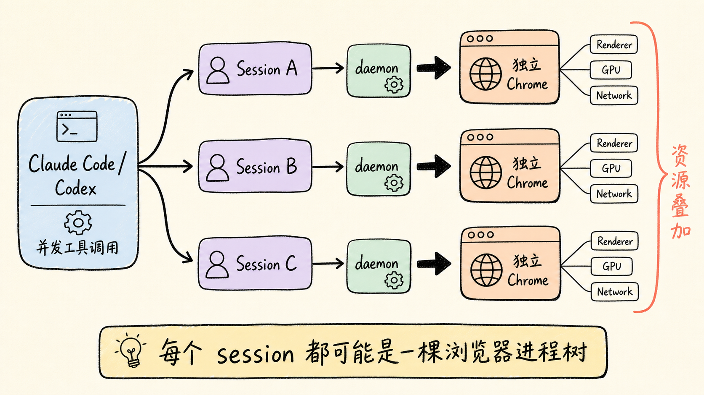
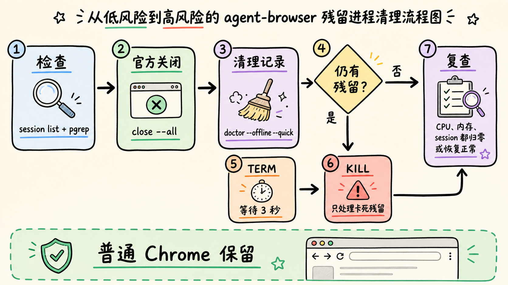
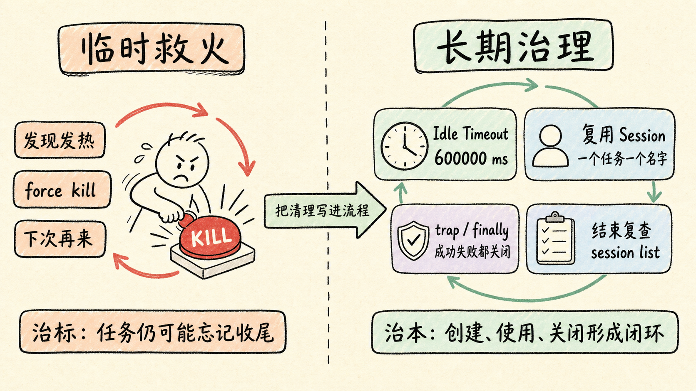

> Claude Code、Codex 明明已经停下来了，Mac 风扇却还在转，内存也迟迟不降。问题可能不在当前会话，而在一批没有正常收尾的 `agent-browser` daemon 与自动化 Chrome。

这次我在本机清理了 **8 组遗留的 agent-browser / Chrome 后台实例及其子进程**。普通 Chrome 标签页没有动，机器热量很快就降了下来。

这不是一个玄学问题，也不能简单归咎于“Chrome 太吃内存”。真正要理解的是：AI 编程工具、浏览器自动化工具、CDP、daemon 和 session 之间，到底是谁启动了谁，又该由谁负责关掉。

<!-- more -->

## 30 秒结论

先给赶时间的人答案：

- `agent-browser` 采用 **CLI + 后台 daemon + Chrome** 的架构，daemon 会故意跨命令常驻，以便下一条指令不用重新启动浏览器。
- 每个独立 session 都可能拥有自己的浏览器实例。Claude Code、Codex 并发执行多个 agent 或工具任务时，session 数量很容易叠加。
- 如果任务异常中断、会话被强制停止，或者调用方忘了执行 `agent-browser close`，后台进程就可能继续存在。
- CDP 只是控制通道，不是泄漏的根因。根因是 **浏览器生命周期没有闭环**。
- 最优先执行官方收尾命令：`agent-browser close --all`。只有正常关闭失败，才按特征匹配并发送 `TERM`，最后才考虑 `KILL`。
- 长期方案是设置空闲超时、复用 session，并要求每个自动化任务在 `finally` 或 shell `trap` 中关闭自己的 session。

## 目录

- [一、现象：AI 停了，浏览器却没停](#一现象ai-停了浏览器却没停)
- [二、根因：常驻 daemon 遇上并发 session](#二根因常驻-daemon-遇上并发-session)
- [三、先确认，不要上来就 kill](#三先确认不要上来就-kill)
- [四、三层清理：官方关闭、温和终止、强制清理](#四三层清理官方关闭温和终止强制清理)
- [五、怎样保证不误伤普通 Chrome](#五怎样保证不误伤普通-chrome)
- [六、从源头预防：让生命周期闭环](#六从源头预防让生命周期闭环)
- [七、可直接收藏的排查清单](#七可直接收藏的排查清单)

## 一、现象：AI 停了，浏览器却没停

典型场景是这样的：

- 你让 Claude Code 或 Codex 通过 skill、MCP、shell 工具打开网页；
- 自动化任务创建了多个命名 session，甚至并行跑了多个子 agent；
- 任务完成或会话终止后，终端已经安静；
- 但“活动监视器”里仍有多组 Chrome、Chrome Helper、GPU、Renderer 或 agent-browser 进程；
- 合上几次窗口也没用，Mac 继续发热，内存和 CPU 占用居高不下。

最迷惑的一点是：这些进程通常没有可见窗口。你看到的普通 Chrome 标签页可能只有几个，但后台自动化 Chrome 使用的是独立临时用户目录，它们和日常浏览器不是同一组实例。

因此，“我已经关掉 Chrome 窗口了”并不能证明自动化浏览器已经退出。

## 二、根因：常驻 daemon 遇上并发 session

以本机安装的 `agent-browser 0.27.0` 为例，官方说明明确写了两件事：

- 它采用 client-daemon 架构，Rust CLI 负责接收命令，Rust daemon 通过 CDP 控制 Chrome；
- daemon 会在第一次命令时自动启动，并在后续命令之间保持运行，以换取更快的响应。

与此同时，官方 session 文档也说明：每个 session 都有独立的浏览器实例、Cookie、存储、历史记录和认证状态。

这两点放到多 agent 场景里，就形成了下面的链路：



```text
Claude Code / Codex
        │

        ├─ Agent A → session A → daemon A → Chrome A → Renderer / GPU / Network

        ├─ Agent B → session B → daemon B → Chrome B → Renderer / GPU / Network

        └─ Agent C → session C → daemon C → Chrome C → Renderer / GPU / Network
```

单看一组并不可怕。真正吃资源的是“多组浏览器进程树一起常驻”。一个 Chrome 主进程还会派生渲染、GPU、网络等子进程，所以 8 个遗留实例在活动监视器里看起来可能远不止 8 行。

### CDP 是不是罪魁祸首？

不是。

CDP（Chrome DevTools Protocol）只是自动化工具与 Chrome 之间的控制协议。它负责导航、点击、读取 DOM、截图等操作，但不会替调用方决定“任务什么时候算结束”。

真正缺失的是这条生命周期：

```text
创建 session → 使用浏览器 → 任务成功或失败 → 关闭 session → 回收 daemon 和 Chrome
```

如果最后两步没有执行，前面的资源就可能继续留在后台。

> **关键判断：** 不是 AI “还在思考”，而是 AI 启动的外部进程已经脱离了当前对话的可见范围。

## 三、先确认，不要上来就 kill

清理前先分清三件事：有多少活动 session、有哪些 agent-browser daemon、哪些 Chrome 使用了 agent-browser 的临时用户目录。

### 1. 查看 agent-browser 自己记录的活动 session

```bash
agent-browser session list
```

如果版本支持 JSON：

```bash
agent-browser session list --json
```

这一步最可信，因为它从工具自己的会话视角回答“现在认为谁还活着”。

### 2. 查看 daemon 和自动化 Chrome

macOS 上可以使用：

```bash
pgrep -fl '/agent-browser/bin/agent-browser-darwin-(arm64|x64)( |$)'

pgrep -fl '[G]oogle Chrome.*--user-data-dir=[^ ]*/agent-browser-chrome-'
```

第二条命令的关键不是进程名“Google Chrome”，而是启动参数中的：

```text
--user-data-dir=.../agent-browser-chrome-...
```

它说明这个 Chrome 使用的是 agent-browser 创建的隔离用户目录，而不是你日常使用的默认 Chrome Profile。

### 3. 按 CPU、内存和运行时间查看完整进程树

```bash
ps -axo pid,ppid,%cpu,%mem,rss,etime,command \
  | grep -E '[a]gent-browser-darwin|[a]gent-browser-chrome-'
```

字段含义：

- `PID`：当前进程编号，后续终止时使用。
- `PPID`：父进程编号，用来判断 daemon 与 Chrome 的父子关系。
- `%CPU`：CPU 占用，观察它是否持续让机器发热。
- `%MEM` / `RSS`：内存占用，确认多个实例是否不断叠加。
- `ETIME`：已运行时间，判断它是否早已超过当前 AI 任务时长。
- `COMMAND`：完整启动命令，确认是否带有 agent-browser 特征参数。

不要只看 `~/.agent-browser` 下有没有 `.pid`、`.sock` 文件。它们可能只是过期的 sidecar 文件，并不等于进程仍然存活。进程是否活着，最终以 `session list`、`ps` 和 `pgrep` 为准。

## 四、三层清理：官方关闭、温和终止、强制清理



### 第一层：让 agent-browser 自己收尾

优先执行：

```bash
agent-browser close --all
```

然后清理过期的 pid、socket、version 等 sidecar 文件：

```bash
agent-browser doctor --offline --quick
```

当前版本的 `doctor` 会自动清理陈旧的 daemon sidecar 文件；`--fix` 还可能执行重装 Chrome、清理旧状态等破坏性修复，因此日常排查先不要加 `--fix`。

再次验证：

```bash
agent-browser session list

pgrep -fl '/agent-browser/bin/agent-browser-darwin-(arm64|x64)( |$)'

pgrep -fl '[G]oogle Chrome.*--user-data-dir=[^ ]*/agent-browser-chrome-'
```

如果没有输出，说明已经清干净。

### 第二层：发送 TERM，让进程有机会优雅退出

只有官方关闭失败时再执行：

```bash
pgrep -f '/agent-browser/bin/agent-browser-darwin-(arm64|x64)( |$)' \
  | xargs -n 1 kill -TERM 2>/dev/null || true

pgrep -f '[G]oogle Chrome.*--user-data-dir=[^ ]*/agent-browser-chrome-' \
  | xargs -n 1 kill -TERM 2>/dev/null || true
```

`TERM` 会给进程处理退出、关闭文件和回收子进程的机会。执行后等 3 秒，再跑一次检查命令。

### 第三层：只对仍残留的目标使用 KILL

```bash
pgrep -f '/agent-browser/bin/agent-browser-darwin-(arm64|x64)( |$)' \
  | xargs -n 1 kill -KILL 2>/dev/null || true

pgrep -f '[G]oogle Chrome.*--user-data-dir=[^ ]*/agent-browser-chrome-' \
  | xargs -n 1 kill -KILL 2>/dev/null || true
```

`KILL` 不允许进程执行清理逻辑，只适合处理已经卡死、无法响应 `TERM` 的残留。正在进行的自动化、下载、表单填写和未保存状态都会立即丢失。

### 仓库里放一个可重复使用的脚本

本文配套脚本已放在：

```text
scripts_py/agent_browser_cleanup.sh
```

使用方式：

```bash
./scripts_py/agent_browser_cleanup.sh status
./scripts_py/agent_browser_cleanup.sh close
./scripts_py/agent_browser_cleanup.sh force
```

三条命令依次对应：只查看、官方关闭并清理 sidecar、官方关闭失败后的分级强制清理。

## 五、怎样保证不误伤普通 Chrome

不要使用下面这种“大锤”：

```bash
killall 'Google Chrome'
pkill -f 'Google Chrome'
```

它们会把普通 Chrome 窗口和日常标签页一起关掉。

本文脚本采用两层限制：

1. daemon 必须匹配 `agent-browser-darwin-arm64` 或 `agent-browser-darwin-x64` 的安装路径；
2. Chrome 必须带有 `--user-data-dir=.../agent-browser-chrome-...` 参数。

也就是说，它针对的是 agent-browser 创建的隔离 Chrome，不是所有名为 Google Chrome 的进程。

不过还有一个例外需要注意：如果你主动使用 `--cdp` 或 `--auto-connect` 连接了日常 Chrome，那么自动化 session 与普通浏览器之间的边界会变得更近。此时先用 `session list` 和完整命令行确认，不要直接执行强制清理。

## 六、从源头预防：让生命周期闭环

清理脚本只是灭火器。更好的办法是让每个任务都负责关掉自己打开的浏览器。



### 1. 设置 daemon 空闲自动退出

官方提供了 `AGENT_BROWSER_IDLE_TIMEOUT_MS`。例如 10 分钟无命令后自动关闭浏览器并退出 daemon：

```bash
export AGENT_BROWSER_IDLE_TIMEOUT_MS=600000
```

长期使用可以写入 `~/.zshrc`：

```bash
echo 'export AGENT_BROWSER_IDLE_TIMEOUT_MS=600000' >> ~/.zshrc
source ~/.zshrc
```

10 分钟只是一个稳妥起点。频繁执行长任务可以设为 30 分钟；偶尔使用、机器资源紧张时可以设为 3 到 5 分钟。

### 2. 不要为每一步创建新 session

同一个任务尽量复用一个语义明确的 session：

```bash
agent-browser --session blog-research open https://example.com
agent-browser --session blog-research snapshot -i
agent-browser --session blog-research close
```

并发任务确实需要隔离时，可以创建多个 session，但每个任务结束后都要单独关闭。

### 3. 在 shell 脚本里用 trap 兜底

```bash
set -euo pipefail

SESSION="research-$$"

cleanup() {
  agent-browser --session "$SESSION" close >/dev/null 2>&1 || true
}

trap cleanup EXIT INT TERM

agent-browser --session "$SESSION" open https://example.com
agent-browser --session "$SESSION" snapshot -i
```

无论脚本正常结束、报错，还是收到中断信号，`cleanup` 都会尝试关闭对应 session。

### 4. 给 Claude Code / Codex 的浏览器 skill 加退出规则

长期指令里应明确写上：

```text
浏览器自动化任务结束后，必须关闭本任务创建的 agent-browser session。

成功、失败、取消和超时都要执行清理；不得依赖用户手动回收后台进程。

并发任务必须记录各自的 session 名称，只关闭自己创建的 session。
```

这比“任务结束后记得关浏览器”更有效，因为它定义了成功、失败和取消三条路径。

### 5. 定期做轻量检查

如果你经常让多个 agent 并发操作网页，可以在结束工作前运行：

```bash
agent-browser session list
./scripts_py/agent_browser_cleanup.sh status
```

发现不认识、运行时间异常长的 session，再决定是否关闭。不要把 `force` 放进高频定时任务，因为它可能打断仍在工作的自动化。

## 七、可直接收藏的排查清单

遇到 Mac 突然发热、内存异常时，按这个顺序走：

- 打开“活动监视器”，确认是否有多组无窗口的 Chrome / agent-browser。
- 运行 `agent-browser session list`，确认活动 session。
- 用 `pgrep -fl` 或 `ps` 检查 daemon 与 `agent-browser-chrome-` 用户目录。
- 先执行 `agent-browser close --all`。
- 再执行 `agent-browser doctor --offline --quick` 清理陈旧 sidecar。
- 等待几秒并复查 CPU、内存和进程。
- 仍有残留时先 `TERM`，最后才 `KILL`。
- 设置 `AGENT_BROWSER_IDLE_TIMEOUT_MS`。
- 在每个自动化脚本或 skill 中加入 `finally` / `trap` 清理。
- 避免 `killall Google Chrome` 这类会误伤普通标签页的命令。

## 最后

浏览器自动化最容易被忽略的，不是“怎么打开网页”，而是“谁负责关闭网页背后的整棵进程树”。

Claude Code 和 Codex 能把网页操作拆成工具调用，却不会天然替所有第三方工具完成生命周期管理。只要调用链中存在 daemon、session 和独立 Chrome，就应该把清理当成任务的一部分，而不是任务结束后的家务。

> **真正可靠的自动化，不只要能启动，还要能在成功、失败和取消时都干净退出。**

如果你的 Mac 也曾在 AI 会话结束后莫名发热，先别急着重启。跑一下本文的检查命令，很可能几分钟就能找到那批“已经下班，但进程还没打卡”的浏览器。

## 参考资料

- [agent-browser 官方仓库](https://github.com/vercel-labs/agent-browser)
- [agent-browser README：命令、Session 与 Architecture](https://github.com/vercel-labs/agent-browser/blob/main/README.md)
- [Chrome for Testing 官方介绍](https://developer.chrome.com/blog/chrome-for-testing/)
- [Chrome DevTools：远程调试](https://developer.chrome.com/docs/devtools/remote-debugging/)
