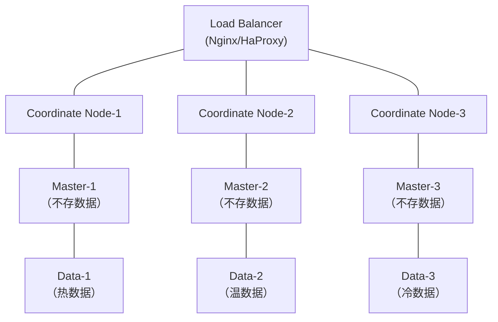

## 目录

- [一、ES 基础概念速查](#一es-基础概念速查)
- [二、集群架构（面试必问）](#二集群架构面试必问)
  - [2.1 节点角色](#21-节点角色)
  - [2.2 典型生产架构](#22-典型生产架构)
  - [2.3 项目中怎么回答集群架构](#23-项目中怎么回答集群架构)
- [三、集群搭建与运维](#三集群搭建与运维)
  - [3.1 核心配置](#31-核心配置)
  - [3.2 JVM 调优](#32-jvm-调优)
  - [3.3 系统级优化](#33-系统级优化)
  - [3.4 日常运维清单](#34-日常运维清单)
- [四、索引设计与调优](#四索引设计与调优)
  - [4.1 分片设计](#41-分片设计)
  - [4.2 Mapping 设计](#42-mapping-设计)
  - [4.3 索引滚动（Rollover）](#43-索引滚动rollover)
- [五、查询性能调优](#五查询性能调优)
  - [5.1 写入调优](#51-写入调优)
  - [5.2 查询调优](#52-查询调优)
  - [5.3 慢查询日志](#53-慢查询日志)
- [六、集群故障处理](#六集群故障处理)
  - [6.1 常见故障与处理](#61-常见故障与处理)
  - [故障4：磁盘水位告警](#故障4磁盘水位告警)
  - [6.2 故障应急 SOP](#62-故障应急-sop)
- [七、Logstash 管理](#七logstash-管理)
  - [7.1 架构与核心概念](#71-架构与核心概念)
  - [7.2 生产配置模板](#72-生产配置模板)
  - [7.3 Logstash 性能调优](#73-logstash-性能调优)
  - [7.4 Logstash 常见问题](#74-logstash-常见问题)
  - [7.5 Logstash vs Filebeat](#75-logstash-vs-filebeat)
- [八、知识库管理（索引生命周期）](#八知识库管理索引生命周期)
  - [8.1 ILM（Index Lifecycle Management）](#81-ilmindex-lifecycle-management)
  - [8.2 冷热架构实现](#82-冷热架构实现)
  - [8.3 索引管理日常操作](#83-索引管理日常操作)
- [九、项目实战话术模板](#九项目实战话术模板)
  - [9.1 日志平台场景](#91-日志平台场景)
  - [9.2 搜索业务场景](#92-搜索业务场景)
- [十、面试高频问题 Q&A](#十面试高频问题-qa)
  - [Q1：ES 写入数据的流程？](#q1es-写入数据的流程)
  - [Q2：ES 搜索数据的流程？](#q2es-搜索数据的流程)
  - [Q3：倒排索引是什么？](#q3倒排索引是什么)
  - [Q4：ES 如何保证高可用？](#q4es-如何保证高可用)
  - [Q5：ES 和数据库如何保证数据一致性？](#q5es-和数据库如何保证数据一致性)
  - [Q6：深分页为什么慢？怎么解决？](#q6深分页为什么慢怎么解决)
  - [Q7：ES 集群脑裂怎么处理？](#q7es-集群脑裂怎么处理)
  - [Q8：如何监控 ES 集群健康？](#q8如何监控-es-集群健康)
- [一、架构对比](#一架构对比)
- [二、核心架构差异](#二核心架构差异)
  - [Kafka：分区模型](#kafka分区模型)
  - [RocketMQ：队列模型](#rocketmq队列模型)
- [三、功能特性对比](#三功能特性对比)
- [四、性能对比](#四性能对比)
- [五、可靠性对比](#五可靠性对比)
  - [Kafka 丢消息场景](#kafka-丢消息场景)
  - [RocketMQ 防丢机制](#rocketmq-防丢机制)
- [六、适用场景](#六适用场景)
  - [Kafka 适合](#kafka-适合)
  - [RocketMQ 适合](#rocketmq-适合)
- [七、面试高频问题](#七面试高频问题)
  - [Q1: 为什么 Kafka 不支持延迟消息？](#q1-为什么-kafka-不支持延迟消息)
  - [Q2: RocketMQ 事务消息原理？](#q2-rocketmq-事务消息原理)
  - [Q3: Kafka 的 ISR 是什么？](#q3-kafka-的-isr-是什么)
  - [Q4: 如何保证消息顺序消费？](#q4-如何保证消息顺序消费)
  - [Q5: 消息积压怎么处理？](#q5-消息积压怎么处理)
- [八、选型一句话](#八选型一句话)
- [引用](#引用)

---

> 自动生成：42 张图，由多模态模型 `doubao-seed-2.0-pro` 一次性识别转写。


# ELK 面试 — Elasticsearch 实战经验

---

## 一、ES 基础概念速查

面试时不要背概念，但要能快速说清楚：

```
集群 (Cluster)
└─ 节点 (Node)
   └─ 索引 (Index)              ← 相当于数据库
      └─ 分片 (Shard)            ← 数据水平拆分
         └─ 段 (Segment)         ← Lucene 底层存储单元
      └─ 副本 (Replica)          ← 分片的冗余拷贝
         └─ 主分片 (Primary)     ← 读写入口
         └─ 副本分片 (Replica)   ← 只读，故障时提升为主
```


面试时不要背概念，但要能快速说清楚：

```
集群 (Cluster)
└─ 节点 (Node)
   └─ 索引 (Index)              ← 相当于数据库
      └─ 分片 (Shard)            ← 数据水平拆分
         └─ 段 (Segment)         ← Lucene 底层存储单元
      └─ 副本 (Replica)          ← 分片的冗余拷贝
         └─ 主分片 (Primary)     ← 读写入口
         └─ 副本分片 (Replica)   ← 只读，故障时提升为主
```

| 概念 | 类比 MySQL | 说明 |
|---|---|---|
| Index | Database | 索引，数据容器 |
| Type（已废弃） | Table | 7.x 移除，一个索引只存一种类型 |
| Document | Row | 一条记录，JSON 格式 |
| Field | Column | 文档中的字段 |
| Mapping | Schema | 字段类型定义 |
| Shard | 分表 | 水平拆分，分布到不同节点 |
| Replica | 主从复制 | 高可用 + 读扩展 |

---

## 二、集群架构（面试必问）


### 2.1 节点角色

| 节点类型 | 职责 | 生产建议 |
|---|---|---|
| Master | 集群管理、元数据、分片分配 | 3 个专用 Master，不存数据 |
| Data | 存储数据、执行 CRUD 和搜索 | 按数据量横向扩展 |
| Coordinating | 路由请求、合并结果 | 大查询场景独立部署 |
| Ingest | 数据预处理（Pipeline） | 有预处理需求时部署 |

**面试要点：** Master 节点必须专用，不存数据不参与查询，避免数据节点 GC 影响 Master 稳定性。

### 2.2 典型生产架构

```
        Load Balancer
        (Nginx/HaProxy)
              │
   ┌──────────┼──────────┐
   │          │          │
Coordinate Coordinate Coordinate    ← 协调节点（2-3个）
 Node-1     Node-2     Node-3
   │          │          │
   │          │          │
Master-1   Master-2   Master-3       ← 专用Master（3个）
```




- Coordinate Node-1、Coordinate Node-2、Coordinate Node-3 ← 协调节点（2-3个）
- Master-1、Master-2、Master-3（不存数据） ← 专用Master（3个）
- Data-1（热数据）、Data-2（温数据）、Data-3（冷数据） ← 数据节点（N个）

### 2.3 项目中怎么回答集群架构

**示例回答：**

我们项目中 ES 集群是 5 节点部署：3 个 Master 专用节点（不存数据）+ 5 个 Data 节点。

数据节点按冷热分层：2 个热节点（SSD，存最近 7 天日志）+ 2 个温节点（HDD，存 30 天数据）+ 1 个冷节点（归档）。

索引按天滚动，通过 ILM 策略自动迁移冷数据。集群总共管理约 2TB 数据，日增 50GB 左右。


**示例回答：**

我们项目中 ES 集群是 5 节点部署：3 个 Master 专用节点（不存数据）+ 5 个 Data 节点。

数据节点按冷热分层：2 个热节点（SSD，存最近 7 天日志）+ 2 个温节点（HDD，存 30 天数据）+ 1 个冷节点（归档）。

索引按天滚动，通过 ILM 策略自动迁移冷数据。集群总共管理约 2TB 数据，日增 50GB 左右。

**关键：** 用数字说话，说清楚节点数量、角色、数据量、增长趋势。

---

## 三、集群搭建与运维

### 3.1 核心配置

```yaml
# elasticsearch.yml — 生产必配项

cluster.name: prod-es-cluster
node.name: node-1
node.roles: [master, data]   # 专用Master设 [master]，数据节点设 [data]

# 发现与选主
discovery.seed_hosts: ["master-1:9300", "master-2:9300", "master-3:9300"]
cluster.initial_master_nodes: ["master-1", "master-2", "master-3"]
discovery.zen.minimum_master_nodes: 2   # 防脑裂，7.x后自动计算

# 内存
bootstrap.memory_lock: true   # 锁定堆内存，禁用swap

# 网络与安全
```


```yaml
# elasticsearch.yml — 生产必配项

cluster.name: prod-es-cluster
node.name: node-1
node.roles: [master, data]   # 专用Master设 [master]，数据节点设 [data]

# 发现与选主
discovery.seed_hosts: ["master-1:9300", "master-2:9300", "master-3:9300"]
cluster.initial_master_nodes: ["master-1", "master-2", "master-3"]
discovery.zen.minimum_master_nodes: 2   # 防脑裂，7.x后自动计算

# 内存
bootstrap.memory_lock: true   # 锁定堆内存，禁用swap

# 网络与安全
network.host: 0.0.0.0
xpack.security.enabled: true
xpack.security.transport.ssl.enabled: true
```

### 3.2 JVM 调优

```
jvm.options

# 堆内存：不超过物理内存50%，不超过32GB（压缩指针阈值）
-Xms16g
-Xmx16g

# GC：JDK11+ 默认G1，通常够用
# 大堆(>32G)考虑ZGC

# 关键参数
-XX:+UseG1GC
-XX:G1HeapRegionSize=16m              # 大堆时调大Region
-XX:InitiatingHeapOccupancyPercent=45  # G1触发标记的阈值
-XX:+HeapDumpOnOutOfMemoryError        # OOM时自动dump
-XX:HeapDumpPath=/data/es_heapdump.hprof
```


```
jvm.options

# 堆内存：不超过物理内存50%，不超过32GB（压缩指针阈值）
-Xms16g
-Xmx16g

# GC：JDK11+ 默认G1，通常够用
# 大堆(>32G)考虑ZGC

# 关键参数
-XX:+UseG1GC
-XX:G1HeapRegionSize=16m              # 大堆时调大Region
-XX:InitiatingHeapOccupancyPercent=45  # G1触发标记的阈值
-XX:+HeapDumpOnOutOfMemoryError        # OOM时自动dump
-XX:HeapDumpPath=/data/es_heapdump.hprof
```

**面试要点：**

- 堆内存 不超过物理内存 50%（另一半给 Lucene 文件缓存）
- 堆内存 不超过 32GB（越过压缩指针阈值，实际可用反而变少）
- `-Xms` 和 `-Xmx` 必须相同（避免运行时动态调整带来的停顿）

### 3.3 系统级优化

```bash
# 1. 关闭swap
swapoff -a
# 或 /etc/fstab 注释swap行

# 2. 文件描述符
echo "* soft nofile 65536" >> /etc/security/limits.conf
echo "* hard nofile 65536" >> /etc/security/limits.conf

# 3. 虚拟内存最大映射数
```


```bash
# 1. 关闭swap
swapoff -a
# 或 /etc/fstab 注释swap行

# 2. 文件描述符
echo "* soft nofile 65536" >> /etc/security/limits.conf
echo "* hard nofile 65536" >> /etc/security/limits.conf

# 3. 虚拟内存最大映射数
echo "vm.max_map_count=262144" >> /etc/sysctl.conf
sysctl -p

# 4. 磁盘IO调度器（SSD用noop, HDD用deadline）
echo noop > /sys/block/sda/queue/scheduler
```

### 3.4 日常运维清单

| 运维项 | 频率 | 方式 |
|---|---|---|
| 集群健康状态 | 实时 | `GET _cluster/health` |
| 节点资源监控 | 5分钟 | `GET _nodes/stats` |
| 索引大小与文档数 | 每天 | `GET _cat/indices?v` |
| 分片分布是否均衡 | 每天 | `GET _cat/shards?v` |
| 慢查询日志 | 实时 | slowlog 配置 |
| 磁盘水位 | 告警 | 磁盘使用 >85% 触发告警 |
| Pending Tasks | 监控 | `GET _cluster/health` 中 number_of_pending_tasks |


## 四、索引设计与调优

### 4.1 分片设计

**主分片数量：**
- 确定后不可修改（只能重建索引）
- 每个分片建议 10-50GB
- 分片数 ≈ 数据总量 / 目标分片大小

**副本分片数量：**
- 可动态调整
- 至少 1 个副本（高可用）
- 读多可加副本扩展读能力

```bash
# 查看分片大小
GET _cat/shards?v&h=index,shard,prirep,store,docs

# 动态调整副本数
PUT my-index/_settings
{
  "number_of_replicas": 2
}
```

**面试要点：分片不是越多越好！** 每个分片消耗内存和 CPU，过多分片导致：

- Master 节点压力增大（管理分片元数据）
- 合并段（Segment Merge）压力
- 搜索时跨分片散射（Scatter-Gather）开销

### 4.2 Mapping 设计


```json
PUT my-index
{
  "mappings": {
    "properties": {
      "timestamp":    { "type": "date" },
      "message":      { "type": "text", "analyzer": "ik_max_word" },
      "level":        { "type": "keyword" },
      "service_name": { "type": "keyword" },
      "trace_id":     { "type": "keyword" },
      "request_time": { "type": "integer", "doc_values": false },
      "tags":         { "type": "keyword" }
    }
  },
  "settings": {
    "number_of_shards": 5,
    "number_of_replicas": 1,
    "refresh_interval": "30s",                 # 调大减少刷新频率
    "translog.durability": "async",            # 异步刷盘，提升写入
    "translog.sync_interval": "30s"
  }
}
```

**Mapping 调优要点：**

| 优化项 | 说明 |
|---|---|
| 不需要全文检索的字段用 `keyword` | 避免不必要的分词开销 |
| 不需要聚合/排序的字段设 `doc_values: false` | 节省磁盘和内存 |
| 不需要检索的字段设 `index: false` | 不建倒排索引，省空间 |
| `text` 字段关闭 `norms` | 不需要评分时关闭 |
| 合理使用 `dynamic: strict` | 防止未知字段污染 Mapping |


**Mapping 调优要点：**

| 优化项 | 说明 |
|---|---|
| 不需要全文检索的字段用 `keyword` | 避免不必要的分词开销 |
| 不需要聚合/排序的字段设 `doc_values: false` | 节省磁盘和内存 |
| 不需要检索的字段设 `index: false` | 不建倒排索引，省空间 |
| `text` 字段关闭 `norms` | 不需要评分时关闭 |
| 合理使用 `dynamic: strict` | 防止未知字段污染 Mapping |

### 4.3 索引滚动（Rollover）

```json
# 按条件自动滚动到新索引
PUT _ilm/policy/log-policy
{
  "policy": {
    "phases": {
      "hot": {
        "min_age": "0ms",
        "actions": {
          "rollover": {
            "max_size": "50gb",         # 单索引超过50GB滚动
            "max_age": "1d"             # 或超过1天滚动
          },
          "set_priority": { "priority": 100 }
        }
      },
      "warm": {
        "min_age": "7d",
        "actions": {
          "shrink": { "number_of_shards": 1 },           # 缩分片
```


```json
          "rollover": {
            "max_size": "50gb",         # 单索引超过50GB滚动
            "max_age": "1d"             # 或超过1天滚动
          },
          "set_priority": { "priority": 100 }
        }
      },
      "warm": {
        "min_age": "7d",
        "actions": {
          "shrink":     { "number_of_shards": 1 },                  # 缩分片
          "forcemerge": { "max_num_segments": 1 },                  # 合并段
          "allocate":   { "require": { "data": "warm" } },          # 迁到温节点
          "set_priority": { "priority": 50 }
        }
      },
      "cold": {
        "min_age": "30d",
        "actions": {
          "allocate":     { "require": { "data": "cold" } },
          "set_priority": { "priority": 0 }
        }
      },
      "delete": {
        "min_age": "90d",
        "actions": {
          "delete": {}    # 90天后自动删除
        }
      }
    }
  }
}
```

---

## 五、查询性能调优


### 5.1 写入调优

| 优化项 | 做法 | 原因 |
|---|---|---|
| Bulk 批量写入 | 单次 5-15MB，不超过 10000 条 | 减少网络往返和事务开销 |
| 调大 refresh_interval | 30s 或关闭（写入完成后手动 refresh） | 减少段生成频率 |
| 异步 translog | `translog.durability: async` | 减少每次写操作 fsync |
| 关闭副本再写入 | 大量导入时先 `replicas=0`，写完再恢复 | 消除副本同步开销 |
| 合理分片数 | 每节点不超过 20 个分片/GB堆 | 避免分片过多拖慢合并 |

```bash
# Bulk 写入示例
POST _bulk
{"index": {"_index": "logs-2024.01.01", "_id": "1"}}
{"timestamp": "2024-01-01T00:00:00", "message": "hello", "level": "INFO"}
{"index": {"_index": "logs-2024.01.01", "_id": "2"}}
{"timestamp": "2024-01-01T00:00:01", "message": "world", "level": "WARN"}
```

### 5.2 查询调优

| 优化项 | 做法 | 原因 |
|---|---|---|
| 用 filter 代替 query | `bool.filter` 不计算评分 | 跳过评分，可缓存 |
| 限制返回字段 | `_source: ["field1", "field2"]` | 避免传输大文档全量数据 |
| 避免通配符开头 | 不用 `*abc`，用 `abc*` | 前缀匹配可用倒排索引 |


```bash
POST _bulk
{"index": {"_index": "logs-2024.01.01", "_id": "1"}}
{"timestamp": "2024-01-01T00:00:00", "message": "hello", "level": "INFO"}
{"index": {"_index": "logs-2024.01.01", "_id": "2"}}
{"timestamp": "2024-01-01T00:00:01", "message": "world", "level": "WARN"}
```

| 优化项 | 做法 | 原因 |
|---|---|---|
| 用 filter 代替 query | `bool.filter` 不计算评分 | 跳过评分，可缓存 |
| 限制返回字段 | `_source: ["field1", "field2"]` | 避免传输大文档全量数据 |
| 避免通配符开头 | 不用 `*abc`，用 `abc*` | 前缀匹配可用倒排索引 |
| 避免深分页 | 不用 `from+size > 10000`，用 `search_after` | 深分页全局排序开销大 |
| 用 routing | 按 `user_id` routing | 减少分片散射 |
| 索引预排序 | `index.sort.field: timestamp` | 时序数据写入即有序，查询更快 |
| 开启查询缓存 | `index.queries.cache.enabled: true` | 重复查询命中缓存 |

```json
# 深分页优化：search_after
GET logs/_search
{
  "size": 100,
  "query": { "match": { "level": "ERROR" } },
  "sort": [
    { "timestamp": "desc" },
    { "_id": "asc" }
  ],
  "search_after": ["2024-01-01T12:00:00", "abc123"]
}
```


### 5.3 慢查询日志

```json
PUT my-index/_settings
{
  "index.search.slowlog.threshold.query.warn": "5s",
  "index.search.slowlog.threshold.query.info": "2s",
  "index.search.slowlog.threshold.fetch.warn": "1s",
  "index.indexing.slowlog.threshold.index.warn": "10s"
}
```

---

## 六、集群故障处理

### 6.1 常见故障与处理

**故障1：节点掉线**

现象：节点从集群中消失，分片变为 Unassigned

排查：
```
GET _cat/nodes?v                                              # 查看存活节点
GET _cluster/health                                           # 查看集群状态 (yellow/red)
GET _cat/shards?v&h=index,shard,prirep,state,node             # 定位未分配分片
```

原因：
- OOM（JVM 堆内存不足）
- GC 停顿过长（超过 30s 被判定离线）
- 网络分区
- 磁盘满（水位 >85% 只读，>95% 强制只读）

处理：


```json
PUT my-index/_settings
{
  "index.search.slowlog.threshold.query.warn": "5s",
  "index.search.slowlog.threshold.query.info": "2s",
  "index.search.slowlog.threshold.fetch.warn": "1s",
  "index.indexing.slowlog.threshold.index.warn": "10s"
}
```

---

**故障1：节点掉线**

现象：节点从集群中消失，分片变为 Unassigned

排查：
```
GET _cat/nodes?v                                              # 查看存活节点
GET _cluster/health                                           # 查看集群状态 (yellow/red)
GET _cat/shards?v&h=index,shard,prirep,state,node             # 定位未分配分片
```

原因：
- OOM（JVM 堆内存不足）
- GC 停顿过长（超过 30s 被判定离线）
- 网络分区
- 磁盘满（水位 >85% 只读，>95% 强制只读）


**故障1：节点掉线**

现象：节点从集群中消失，分片变为 Unassigned

排查：
```
GET _cat/nodes?v                                              # 查看存活节点
GET _cluster/health                                           # 查看集群状态 (yellow/red)
GET _cat/shards?v&h=index,shard,prirep,state,node             # 定位未分配分片
```

原因：
- OOM（JVM 堆内存不足）
- GC 停顿过长（超过 30s 被判定离线）
- 网络分区
- 磁盘满（水位 >85% 只读，>95% 强制只读）

处理：
1. 排查节点日志：`/var/log/elasticsearch/集群名.log`
2. 如果是 OOM：调整堆内存或优化查询
3. 如果是磁盘满：清理旧索引或扩容
4. 如果是网络：修复网络后等节点自动加入
5. 紧急情况手动分配分片：

```json
POST _cluster/reroute
{
  "commands": [{
    "allocate_stale_primary": {
      "index": "my-index", "shard": 0, "node": "node-1", "accept_data_loss": true
    }
  }]
}
```

**故障2：集群 Red / Yellow**

Red：有主分片未分配，数据不完整
Yellow：有副本分片未分配，主分片正常


**故障2：集群 Red / Yellow**

Red：有主分片未分配，数据不完整
Yellow：有副本分片未分配，主分片正常

排查步骤：
```
1. GET _cluster/health?pretty                                       # 确认状态
2. GET _cluster/allocation/explain                                  # 查看分片未分配原因
3. GET _cat/shards?v&h=index,shard,prirep,state,unassigned.reason
```

常见原因与解决：

| 未分配原因 | 解决方案 |
|---|---|
| 磁盘水位超限 | 清理索引/扩磁盘/调高水位线 |
| 节点掉线 | 恢复节点或手动 reroute |
| 分片数超限 | 调大 `cluster.max_shards_per_node` |
| 副本数 > 数据节点 | 减少副本数或增加数据节点 |
| 主分片数据损坏 | 从副本提升或接受数据丢失恢复 |

**故障3：脑裂（Split Brain）**

现象：集群出现两个 Master，数据不一致
原因：网络分区导致部分节点选出新 Master

预防（7.x+ 已大幅改善）：
- 专用 Master 节点（3个）
- `minimum_master_nodes` 自动计算（N/2 + 1）
- 配置 `discovery.seed_hosts` 只指向 Master 节点

恢复：
1. 立即隔离少数派节点


```
预防（7.x+已大幅改善）：
- 专用 Master 节点（3个）
- minimum_master_nodes 自动计算 (N/2 + 1)
- 配置 discovery.seed_hosts 只指向 Master 节点

恢复：
1. 立即隔离少数派节点
2. 确认数据最新的一侧为正确集群
3. 重启少数派节点重新加入
4. 严重时需从快照恢复
```

### 故障4：磁盘水位告警

```
ES 磁盘水位线：
cluster.routing.allocation.disk.watermark.low:        85%  → 不再分配新分片到该节点
cluster.routing.allocation.disk.watermark.high:       90%  → 开始迁移分片走
cluster.routing.allocation.disk.watermark.flood_stage: 95% → 索引设为只读

紧急处理：
1. 删除旧索引释放空间
2. 临时调高水位线（不推荐长期）：
   PUT _cluster/settings
   {
     "persistent": {
       "cluster.routing.allocation.disk.watermark.low": "90%",
       "cluster.routing.allocation.disk.watermark.high": "95%",
       "cluster.routing.allocation.disk.watermark.flood_stage": "98%"
     }
   }
3. 解除只读：
   PUT my-index/_settings
   { "index.blocks.read_only_allow_delete": null }
```

### 6.2 故障应急 SOP

---


```
发现故障
  │
  ├─ 1. GET _cluster/health         → 确认 Red/Yellow
  │
  ├─ 2. GET _cat/allocation         → 检查磁盘水位
  │
  ├─ 3. GET _cluster/allocation/explain → 定位未分配原因
  │
  ├─ 4. 查看节点日志                → 排查 OOM/GC/网络
  │
  ├─ 5. 紧急止血
  │      ├─ 磁盘满  → 删旧索引 / 调水位线
  │      ├─ 节点挂  → 等自动恢复或重启
  │      ├─ 查询压垮 → 限流 / 杀慢查询
  │      └─ 数据损坏 → 从快照恢复
  │
  └─ 6. 恢复后验证
         ├─ GET _cluster/health     → Green
         ├─ GET _cat/recovery       → 分片恢复进度
         └─ 业务验证查询正常
```

## 七、Logstash 管理

### 7.1 架构与核心概念

```
Input → Filter → Output

Input:  数据源（Kafka、File、Redis、TCP...）
```

---


```
Input → Filter → Output

Input:  数据源（Kafka、File、Redis、TCP...）
Filter: 数据处理（grok解析、字段增删、类型转换...）
Output: 输出目标（ES、Kafka、File...）
```

### 7.2 生产配置模板

```
# logstash.conf

input {
  kafka {
    bootstrap_servers => "kafka-1:9092,kafka-2:9092,kafka-3:9092"
    topics => ["app-logs", "access-logs"]
    group_id => "logstash-consumer"
    consumer_threads => 4
    decorate_events => true              # 携带Kafka元数据
    auto_offset_reset => "latest"
  }
}

filter {
  # JSON 日志直接解析
  if [message] =~ /^\{/ {
    json {
```

---


```
      decorate_events => true              # 携带Kafka元数据
      auto_offset_reset => "latest"
    }
  }

filter {
  if [message] =~ /^\{/ {
    json {
      source => "message"
      target => "parsed"                   # 解析到 parsed 字段下
    }
  }

  # 非 JSON 日志用 grok 解析
  if [message] !~ /^\{/ {
    grok {
      match => { "message" => "%{TIMESTAMP_ISO8601:timestamp} %{LOGLEVEL:level} %{GREEDYDATA:msg}" }
    }
  }

  # 时间戳处理
  date {
    match => ["timestamp", "ISO8601"]
    target => "@timestamp"
  }

  # 字段增删
  mutate {
    remove_field => ["message", "parsed"]
    rename => { "[parsed][service]" => "service_name" }
    lowercase => ["level"]
  }

  # 根据 level 添加标签
  if [level] in ["ERROR", "FATAL"] {
    mutate { add_tags => ["alert"] }
  }
}
```

---


```
output {
  elasticsearch {
    hosts => ["es-data-1:9200", "es-data-2:9200", "es-data-3:9200"]
    index => "logs-%{[service_name]}-%{+YYYY.MM.dd}"   # 按服务名+日期分索引
    user => "logstash_writer"
    password => "${LOGSTASH_PASSWORD}"                  # 环境变量引用密码
    ssl => true
    ssl_certificate_verification => true

    # 批量写入优化
    flush_size => 500              # 积累500条批量写入
    idle_flush_time => 5           # 最多5秒刷新一次
  }

  # ERROR 级别同时告警
  if "alert" in [tags] {
    webhook {
      url => "https://hooks.example.com/alert"
      http_method => "post"
    }
  }
}
```

### 7.3 Logstash 性能调优

| 优化项 | 配置 | 说明 |
|---|---|---|
| Pipeline Workers | pipeline.workers: 4 | CPU核数，并行处理 |
| Batch Size | pipeline.batch.size: 125 | 每批处理事件数 |
| Batch Delay | pipeline.batch.delay: 50 | 批次等待时间(ms) |
| JVM 堆 | -Xms2g -Xmx2g | 根据队列大小调整 |
| 队列类型 | queue.type: persisted | 持久化队列防数据丢失 |

---


| 优化项 | 配置 | 说明 |
|---|---|---|
| Pipeline Workers | pipeline.workers: 4 | CPU核数，并行处理 |
| Batch Size | pipeline.batch.size: 125 | 每批处理事件数 |
| Batch Delay | pipeline.batch.delay: 50 | 批次等待时间(ms) |
| JVM 堆 | -Xms2g -Xmx2g | 根据队列大小调整 |
| 队列类型 | queue.type: persisted | 持久化队列防数据丢失 |
| 队列容量 | path.queue: /data/queue | 持久化队列存储路径 |

### 7.4 Logstash 常见问题

```
问题1: Logstash OOM
  → 调大堆内存 / 减小 batch size / 检查 grok 是否回溯过多

问题2: 写入ES延迟
  → 检查 ES 集群健康 / 调大 flush_size / 检查 refresh_interval

问题3: Kafka 消费延迟（lag）
  → 增加 consumer_threads / 增加 pipeline.workers / 扩容 Logstash

问题4: Grok 解析失败
  → 添加 _grokparsefailure 监控 / 用 CSV/JSON 替代 grok / 预处理日志格式

问题5: 数据丢失
  → 使用 persisted 队列 / 检查 at-least-once 语义 / 确保 Kafka offset 提交
```

---


### 7.5 Logstash vs Filebeat

```
Filebeat: 轻量采集器，只负责读文件和转发，资源占用极低
Logstash: 重型处理器，负责过滤、转换、富化

生产推荐架构：

应用 → Filebeat → Kafka → Logstash → Elasticsearch
        采集      缓冲     处理        存储

为什么加 Kafka?
  1. 解耦：ES 慢了不影响应用日志输出
  2. 缓冲：突发流量不丢数据
  3. 多消费：同一日志可被多个 Logstash 消费（ES + 实时告警）
```

---

## 八、知识库管理（索引生命周期）

### 8.1 ILM（Index Lifecycle Management）

```
Hot（热）→ Warm（温）→ Cold（冷）→ Delete（删除）
 0-7天     7-30天      30-90天     90天后

Hot:    SSD，高频读写，多分片
Warm:   HDD，低频读，缩减分片
Cold:   归档，极少访问，可 searchable snapshot
Delete: 自动清理
```

---


```
Hot（热）→ Warm（温）→ Cold（冷）→ Delete（删除）
 0-7天     7-30天      30-90天     90天后

Hot:    SSD，高频读写，多分片
Warm:   HDD，低频读，缩减分片
Cold:   归档，极少访问，可 searchable snapshot
Delete: 自动清理
```

### 8.2 冷热架构实现

```
1. 节点打标签
# elasticsearch.yml
node.attr.data: hot      # 热节点
node.attr.data: warm     # 温节点
node.attr.data: cold     # 冷节点

# 2. ILM 策略
PUT _ilm/policy/log-policy
{
  "policy": {
    "phases": {
      "hot": {
        "actions": {
          "rollover": { "max_size": "50gb", "max_age": "1d" },
          "set_priority": { "priority": 100 }
        }
      },
      "warm": {
        "min_age": "7d",
        "actions": {
          "shrink": { "number_of_shards": 1 },
```

---


```
      "cold": {
        "min_age": "30d",
        "actions": {
          "allocate": { "require": { "data": "cold" } },
          "set_priority": { "priority": 0 }
        }
      },
      "delete": {
        "min_age": "90d",
        "actions": { "delete": {} }
      }
    }
  }
}

# 3. 索引模板绑定 ILM
PUT _index_template/logs-template
{
  "index_patterns": ["logs-*"],
  "template": {
    "settings": {
      "number_of_shards": 3,
      "number_of_replicas": 1,
      "lifecycle.name": "log-policy",
      "lifecycle.rollover_alias": "logs"
    }
  }
}
```

### 8.3 索引管理日常操作

```
# 查看索引大小
GET _cat/indices?v&h=index,store.size,docs.count,pri,rep&s=store.size:desc

# 查看分片分布
GET _cat/shards?v&h=index,shard,prirep,state,store,node&s=index
```

---


```
# 查看索引大小
GET _cat/indices?v&h=index,store.size,docs.count,pri,rep&s=store.size:desc

# 查看分片分布
GET _cat/shards?v&h=index,shard,prirep,state,store,node&s=index

# 手动迁移索引到温节点
PUT logs-2024.01.01/_settings
{
  "index.routing.allocation.require.data": "warm"
}

# 强制合并段（减少段数量，提升查询性能）
POST logs-2024.01.01/_forcemerge?max_num_segments=1

# 关闭索引（不删除，不占资源，需要时可 reopen）
POST logs-2023.01.01/_close

# 删除索引
DELETE logs-2023.01.01

# 索引统计
GET _stats?human&fielddata=true
```

## 九、项目实战话术模板

面试时，不要背概念，要讲项目。以下模板根据常见项目场景组织：

### 9.1 日志平台场景

我们用 ELK 搭建了统一日志平台，覆盖 50+ 微服务，日增日志约 80GB。

---


面试时，不要背概念，要讲项目。以下模板根据常见项目场景组织：

> 我们用 ELK 搭建了统一日志平台，覆盖 50+ 微服务，日增日志约 80GB。
>
> **采集链路**：Filebeat 采集 → Kafka 缓冲 → Logstash 处理 → ES 存储 → Kibana 展示
>
> **ES 集群**：3 Master + 5 Data（2热2温1冷），热节点 SSD，温冷节点 HDD，总数据量约 3TB。
>
> **索引设计**：按服务名 + 日期分索引（`logs-{service}-{date}`），每天 Rollover，主分片 3 个，副本 1 个。
>
> **生命周期**：ILM 策略，7 天后迁温节点并 shrink 到 1 分片，30 天迁冷节点，90 天删除。
>
> **调优**：Bulk 写入 500 条/批，refresh_interval 调到 30s，查询用 filter 替代 query，深分页用 search_after。
>
> **告警**：Logstash 解析出 ERROR 日志通过 Webhook 推到钉钉，ES 磁盘 >85% 触发告警。

### 9.2 搜索业务场景

---


> 我们用 ES 做商品搜索，索引约 2000 万商品，QPS 峰值 3000。
>
> **集群**：3 Master + 6 Data + 2 Coordinating，数据节点 64GB 内存 + SSD。
>
> **索引设计**：主分片 8 个（每个约 5GB），副本 2 个（读扩展 + 高可用）。Mapping 中商品名 text + keyword 双字段，分类/品牌用 keyword 支持聚合。
>
> **查询优化**：用 bool.filter 过滤固定条件（分类、价格区间），match 查关键词，function_score 做销量加权排序。预热查询缓存。
>
> **写入策略**：商品更新走 Bulk API，单次 15MB，关闭写入时的 refresh（设 refresh_interval=-1），写完手动 refresh 再恢复。
>
> **故障处理**：遇到过一次磁盘 95% 导致索引只读，通过删除旧索引 + 调高水位线 + 解除只读恢复。之后加了磁盘监控告警。

## 十、面试高频问题 Q&A

### Q1：ES 写入数据的流程？

```
1. 客户端发送写请求到 Coordinating 节点
2. Coordinating 节点根据 routing 确定主分片所在节点，转发请求
3. 主分片写入数据 → 写入内存 Buffer → 同时写入 Translog
4. 每隔 refresh_interval（默认1s），Buffer 中的数据写入 Segment（此时可搜索）
5. 主分片写入成功后，并行转发到所有副本分片
6. 所有副本确认后，返回客户端成功
7. 每隔一段时间（或 Translog 达到阈值），执行 Flush → Segment 持久化 + 清空 Translog
```

### Q2：ES 搜索数据的流程？

```
查询阶段（Query Phase）：
  1. 客户端发送搜索请求到 Coordinating 节点
```

---


```
1. 客户端发送写请求到 Coordinating 节点
2. Coordinating 节点根据 routing 确定主分片所在节点，转发请求
3. 主分片写入数据 → 写入内存 Buffer → 同时写入 Translog
4. 每隔 refresh_interval（默认1s），Buffer 中的数据写入 Segment（此时可搜索）
5. 主分片写入成功后，并行转发到所有副本分片
6. 所有副本确认后，返回客户端成功
7. 每隔一段时间（或 Translog 达到阈值），执行 Flush → Segment 持久化 + 清空 Translog
```

```
查询阶段（Query Phase）：
  1. 客户端发送搜索请求到 Coordinating 节点
  2. Coordinating 将请求转发到所有相关分片（主或副本）
  3. 每个分片返回匹配文档的 ID 和排序值

取回阶段（Fetch Phase）：
  4. Coordinating 合并排序，确定最终文档列表
  5. 向相关分片请求完整文档内容
  6. 汇总后返回客户端
```

### Q3：倒排索引是什么？

```
正排索引：文档ID → 内容（知道文档找内容）
倒排索引：词项 → 文档ID列表（知道词找文档）

示例：
  Doc1: "hello world"
  Doc2: "hello elasticsearch"

倒排索引：
  Term            DocIDs
  hello       →   [1, 2]
```

---


```
正排索引：文档ID → 内容（知道文档找内容）
倒排索引：词项 → 文档ID列表（知道词找文档）

示例：
  Doc1: "hello world"
  Doc2: "hello elasticsearch"

倒排索引：
  Term              DocIDs
  hello         →   [1, 2]
  world         →   [1]
  elasticsearch →   [2]

搜索 "hello" → 直接从倒排索引找到 Doc1, Doc2
```

### Q4：ES 如何保证高可用？

```
1. 副本机制：每个主分片有副本分片，分布在不同节点
2. Master 选举：3个专用Master，N/2+1选举，防脑裂
3. 分片自动恢复：节点掉线后，Master 自动在其他节点重建分片
4. Translog：写入前先写日志，崩溃后可恢复
5. Gateway：集群元数据持久化，重启后可恢复
```

### Q5：ES 和数据库如何保证数据一致性？

```
方案1：双写（最常用）
  业务代码同时写 DB 和 ES
  优点：简单
  缺点：可能不一致，需补偿机制

方案2：异步消息（推荐）
```

---


```
方案1：双写（最常用）
  业务代码同时写 DB 和 ES
  优点：简单
  缺点：可能不一致，需补偿机制

方案2：异步消息（推荐）
  DB → Binlog（Canal/Debezium）→ Kafka → ES
  优点：解耦，最终一致
  缺点：有延迟（通常秒级）

方案3：定期全量同步
  定时任务从 DB 拉数据刷到 ES
  优点：可靠
  缺点：实时性差

方案4：Change Data Capture (CDC)
  Canal 监听 MySQL Binlog → 写入 ES
  优点：对业务无侵入
  缺点：引入 Canal 组件复杂度
```

### Q6：深分页为什么慢？怎么解决？

```
为什么慢：
  from=9990, size=10
  → 每个分片返回前 10000 条给 Coordinating 节点
  → Coordinating 对 N×10000 条全局排序
  → 取第 9991-10000 条
  → 丢掉 9990 条，浪费大量计算

解决方案：
  1. search_after：基于上一页最后一条的排序值翻页，适合实时深翻页
  2. scroll：创建快照遍历，适合批量导出（不推荐实时查询）
  3. 业务限制：限制最大翻页数（如最多100页）
```

---


```
为什么慢：
  from=9990, size=10
  → 每个分片返回前 10000 条给 Coordinating 节点
  → Coordinating 对 N×10000 条全局排序
  → 取第 9991-10000 条
  → 丢掉 9990 条，浪费大量计算

解决方案：
  1. search_after：基于上一页最后一条的排序值翻页，适合实时深翻页
  2. scroll：创建快照遍历，适合批量导出（不推荐实时查询）
  3. 业务限制：限制最大翻页数（如最多100页）
```

### Q7：ES 集群脑裂怎么处理？

```
预防（7.x+已大幅改善）：
  - 专用 Master 节点，不存数据
  - minimum_master_nodes 自动计算（N/2+1）
  - 配置 discovery.seed_hosts

恢复：
  1. 立即隔离少数派节点
  2. 确认数据最新的一侧为正确集群
  3. 重启少数派节点重新加入
  4. 严重时从快照恢复
```

### Q8：如何监控 ES 集群健康？

```
核心指标：
  - 集群状态：Green / Yellow / Red
  - 节点数：是否与预期一致
  - 未分配分片数：number_of_unassigned_shards
```

---


```
预防（7.x+已大幅改善）：
  - 专用 Master 节点，不存数据
  - minimum_master_nodes 自动计算（N/2+1）
  - 配置 discovery.seed_hosts

恢复：
  1. 立即隔离少数派节点
  2. 确认数据最新的一侧为正确集群
  3. 重启少数派节点重新加入
  4. 严重时从快照恢复
```

```
核心指标：
  - 集群状态：Green / Yellow / Red
  - 节点数：是否与预期一致
  - 未分配分片数：number_of_unassigned_shards
  - JVM 堆使用率：< 75% 正常
  - GC 频率和耗时：Young GC 频繁或 Full GC 需关注
  - 磁盘使用率：< 85%
  - 索引速率 / 搜索延迟
  - Pending Tasks：长时间 > 0 需关注

监控工具：
  - Kibana Stack Monitoring
  - Elasticsearch Exporter + Prometheus + Grafana
  - 阿里云/腾讯云 ES 自带监控
```

---


# Kafka vs RocketMQ 核心区别

## 一、架构对比

| 维度 | Kafka | RocketMQ |
|---|---|---|


# Kafka与RocketMQ区别

| 维度 | Kafka | RocketMQ |
|------|-------|----------|
| 开发语言 | Scala + Java | Java |
| 定位 | 分布式流处理平台 | 分布式消息中间件 |
| 社区生态 | Apache 顶级项目，生态极强 | Apache 项目，阿里系生态 |
| 协议 | 自定义协议 | 自定义协议 + 兼容 JMS |

## 二、核心架构差异

### Kafka：分区模型

```
Topic → 多个 Partition → 每个 Partition 只属于一个 Broker
                ↓
        Partition 内有序，跨 Partition 无序
        消费者组内一个 Partition 只能被一个 Consumer 消费
```

- 扩展性靠增加 Partition
- 顺序性只在 Partition 内保证

### RocketMQ：队列模型

```
Topic → 多个 MessageQueue → 每个 Queue 只属于一个 Broker
```

---


```
Topic → 多个 MessageQueue → 每个 Queue 只属于一个 Broker
                ↓
        引入 MessageQueue + 分组机制
        支持 MessageQueue 级别的顺序消费
```

- MessageQueue 概念类似 Partition，但语义更丰富
- 天然支持局部顺序消息和全局顺序消息

## 三、功能特性对比

| 特性 | Kafka | RocketMQ |
|------|-------|----------|
| 延迟消息 | 不支持（需自行实现） | 支持 18 个级别延迟 |
| 事务消息 | 支持（Exactly Once 语义） | 支持（半消息 + 回查机制） |
| 顺序消息 | Partition 内有序 | Queue 内有序 + 全局有序 |
| 消息回溯 | 按 Offset 回溯 | 按时间戳回溯，更灵活 |
| 死信队列 | 不内置 | 内置 DLQ，消费失败自动转入 |
| 消息过滤 | 只能按 Topic/Partition | 支持 Tag 过滤 + SQL92 过滤 |
| 消息轨迹 | 不内置 | 内置消息轨迹，可追踪全链路 |
| 定时消息 | 不支持 | 支持 |

## 四、性能对比

---


| 指标 | Kafka | RocketMQ |
|------|-------|----------|
| 单机 TPS | 百万级（大消息、批处理） | 10万+ 级 |
| 延迟 | ms 级（批处理攒批时更高） | 更低延迟，ms 级 |
| 小消息性能 | 一般（批处理优势不明显） | 更优（针对小消息优化） |
| 消息大小 | 适合大消息/日志 | 适合中小消息/业务 |

**关键差异：**

- Kafka 强在大吞吐批处理场景（日志、大数据管道）
- RocketMQ 强在低延迟、小消息、业务场景

## 五、可靠性对比

| 维度 | Kafka | RocketMQ |
|------|-------|----------|
| 刷盘策略 | 异步刷盘为主 | 同步刷盘 + 异步刷盘可选 |
| 同步复制 | 支持 ISR 机制 | 支持同步双写 + 异步复制 |
| 消息丢失风险 | 配置不当可能丢 | 同步刷盘 + 同步双写 = 零丢失 |
| 消费确认 | Offset 提交 | ACK 机制，更严格 |

### Kafka 丢消息场景

```
Producer：acks=0 或 acks=1 时，Leader 挂了但 Follower 未同步 → 丢失
```

---


```
Producer：acks=0 或 acks=1 时，Leader 挂了但 Follower 未同步 → 丢失
Broker：  异步刷盘，宕机时未刷盘的消息丢失
Consumer：自动提交 Offset，消费失败但 Offset 已提交 → 丢失
```

### RocketMQ 防丢机制

```
Producer：同步发送 + 重试
Broker：  同步刷盘 + 同步双写 → 确保持久化再返回 ACK
Consumer：消费成功才 ACK，失败重试 → 最多重试 16 次 → 死信队列
```

## 六、适用场景

### Kafka 适合

- 日志采集：ELK 体系、日志管道
- 大数据流处理：Flink/Spark Streaming 数据源
- 事件流平台：事件驱动架构、CDC
- 高吞吐批处理：大消息、批量写入

### RocketMQ 适合

- 业务消息：订单、支付、交易等金融级场景
- 延迟/定时消息：超时取消、延迟通知
- 事务消息：分布式事务中的最终一致性
- 消息过滤：同一 Topic 下按 Tag 精准投递
- 消息追踪：需要全链路消息轨迹审计

---


- 业务消息：订单、支付、交易等金融级场景
- 延迟/定时消息：超时取消、延迟通知
- 事务消息：分布式事务中的最终一致性
- 消息过滤：同一 Topic 下按 Tag 精准投递
- 消息追踪：需要全链路消息轨迹审计

## 七、面试高频问题

### Q1: 为什么 Kafka 不支持延迟消息？

> Kafka 设计目标是高吞吐日志管道，延迟消息需要时间轮/延迟队列机制，会引入复杂度和性能开销，与其定位不符。RocketMQ 面向业务场景，内置 18 级延迟级别（1s/5s/10s/...2h），用时间轮实现。

### Q2: RocketMQ 事务消息原理？

1. Producer 发送半消息 (Half Message) → Broker 暂存，Consumer 不可见
2. 执行本地事务
3. 根据本地事务结果 → 提交 (Commit) 或回滚 (Rollback)
4. 如果长时间未提交/回滚 → Broker 回查 Producer 本地事务状态
5. 根据回查结果决定投递或删除

### Q3: Kafka 的 ISR 是什么？

> ISR = In-Sync Replicas，与 Leader 保持同步的副本集合。Producer 设 `acks=all` 时，消息写入所有 ISR 副本才返回成功。如果 Follower 落后太多会被踢出 ISR，保证可用性。

---


> ISR = In-Sync Replicas，与 Leader 保持同步的副本集合。Producer 设 `acks=all` 时，消息写入所有 ISR 副本才返回成功。如果 Follower 落后太多会被踢出 ISR，保证可用性。

### Q4: 如何保证消息顺序消费？

| 方案 | Kafka | RocketMQ |
|------|-------|----------|
| 局部有序 | 同一 Key 发到同一 Partition | 同一 Key 发到同一 Queue |
| 全局有序 | 不支持（只能 1 个 Partition） | 1 个 Queue 即全局有序 |
| 消费端 | 单线程消费同一 Partition | MessageListenerOrderly 顺序消费 |

### Q5: 消息积压怎么处理？

1. 紧急扩容 Consumer 实例（Kafka 需同步扩 Partition）
2. 临时消费者：快速消费后转储 → 离线补消费
3. 跳过非关键消息，后续补数据
4. RocketMQ 可按时间戳回溯重新消费
5. 根本原因：排查消费端慢查询/异常

## 八、选型一句话

> 日志/大数据选 Kafka，业务/金融选 RocketMQ。

## 引用
