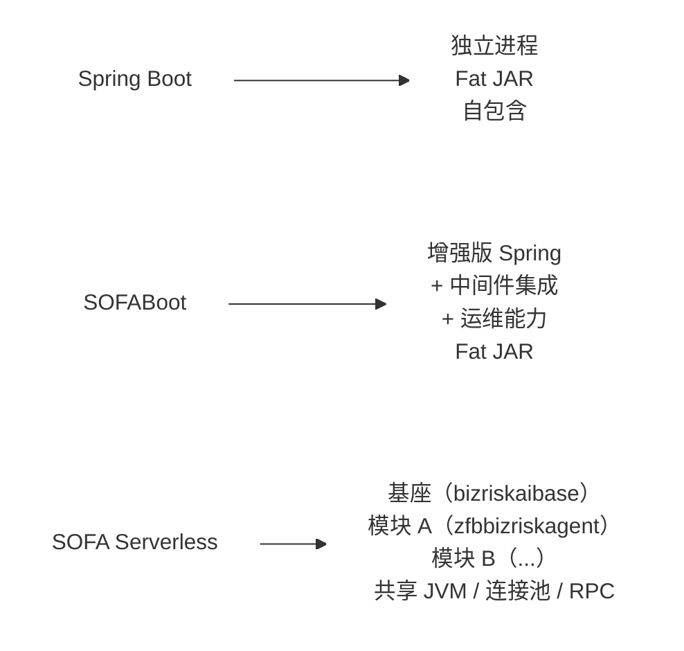

## 目录

- [一图总览](#一图总览)
- [一、Spring Boot](#一spring-boot)
  - [核心定位](#核心定位)
  - [关键特性](#关键特性)
  - [局限](#局限)
- [二、SOFABoot](#二sofaboot)
  - [比 Spring Boot 多了什么](#比-spring-boot-多了什么)
  - [关键差异](#关键差异)
  - [在你项目中的体现](#在你项目中的体现)
- [三、SOFA Serverless（模块化部署）](#三sofa-serverless模块化部署)
- [架构模型](#架构模型)
- [三个核心概念](#三个核心概念)
  - [1. 基座（Base）](#1-基座base)
  - [2. 模块（Ark Biz）](#2-模块ark-biz)
  - [3. ClassLoader 隔离](#3-classloader-隔离)
  - [模块瘦身：三层排除策略](#模块瘦身三层排除策略)
  - [热部署流程](#热部署流程)
  - [在你项目中的声明](#在你项目中的声明)
- [四、三者核心差异对比](#四三者核心差异对比)
  - [4.1 部署与发布](#41-部署与发布)
  - [4.2 资源利用](#42-资源利用)
  - [4.3 隔离性](#43-隔离性)
  - [4.4 开发体验](#44-开发体验)
- [五、你项目里的具体落地](#五你项目里的具体落地)
  - [5.1 模块结构](#51-模块结构)
  - [5.2 基座依赖瘦身](#52-基座依赖瘦身)
  - [5.3 非 Web 模式启动](#53-非-web-模式启动)
  - [5.4 Serverless 调度任务](#54-serverless-调度任务)
  - [5.5 玲珑平台 CI/CD](#55-玲珑平台-cicd)
- [六、面试话术](#六面试话术)
  - ["SOFABoot 和 Spring Boot 有什么区别？"](#sofaboot-和-spring-boot-有什么区别)
  - ["Serverless 模块化部署和普通 Spring Boot 部署有什么区别？"](#serverless-模块化部署和普通-spring-boot-部署有什么区别)
  - ["你们为什么选模块化部署？有什么取舍？"](#你们为什么选模块化部署有什么取舍)
  - ["模块瘦身怎么做的？"](#模块瘦身怎么做的)
- [引用](#引用)

---

> 自动生成：16 张图，由多模态模型 `doubao-seed-2.0-pro` 一次性识别转写。


# Spring Boot vs SOFABoot vs SOFA Serverless 面试对比
> 结合 zfbbizriskagent 项目实战，讲清楚三者的区别和你为什么选 SOFABoot 模块化部署

---

## 一图总览


---
（左侧项目文件列表：）
```
Project
├── shejimoshi
│   ├── abstract-factory
│   ├── factory-method
│   └── simple-factory
├── 简历
├── .gitignore
├── agent-browser原理与实战-riskcybers
├── API-First双协议分层-riskcyberstaff.m
├── BCN网络接入-riskcyberstaff.md
├── DDD面试.md
├── ELK面试-Elasticsearch实战.md
├── Kafka与RocketMQ区别.md
├── Kimi WebBridge-vs-agent-browser-v
├── Kimi WebBridge原理面试.md
├── Multi-Agent挑战与解决方案-zfbbizrisk
├── MyBatis原理.md
├── nanobot核心架构面试.md
├── OD算法.md
├── PowerMem 记忆框架详解（面试版）.m
├── PowerMem记忆框架详解-riskcybersta
├── README.md
├── SOFABoot基座部署与SpringBoot区别.
├── Spring Bean循环依赖.md
├── Spring Bean生命周期.md
├── ⬇ SpringBoot与SOFABoot与Serverless对
├── SpringBoot自动装配原理.md
├── Spring与SpringBoot面试.md
├── SSE与Streamable HTTP对比.md
├── SSE协议对比HTTP-HTTPS-WebSocket
├── synchronized与ReentrantLock区别.m
├── TCP三次握手与四次挥手.md
├── TR-gRPC-MOSN原理详解.md
├── 为什么有了分库还要分表.md
├── 决策引擎架构流程详解.md
├── 原生与非原生Agent区别及反思规划实
├── 可复用设计模式与架构-bizriskide.md
├── 可复用设计模式与架构-zfbbizriskagen
├── 浏览器工具原理.md
└── 系统不足与优化方案.md
```
（顶部标签栏：`解-riskcyberstaff.md`、`Spring Bean循环依赖.md`、`Spring Bean生命周期.md`、`SpringBoot与SOFABoot与Serverless对比.md`）


| 对比维度 | Spring Boot | SOFABoot | SOFA Serverless |
| --- | --- | --- | --- |
| 部署粒度 | 粗 | → | 细 |
| 资源利用 | 低 | → | 高 |
| 隔离性 | 高 | → | 中 |

| 维度 | Spring Boot | SOFABoot | SOFA Serverless |
| --- | --- | --- | --- |
| 打包产物 | Fat JAR（自包含） | Fat JAR（增强版） | Ark Biz JAR（轻量模块包） |
| 运行方式 | 独立 JVM 进程 | 独立 JVM 进程 | 多模块共享一个基座 JVM |
| 依赖管理 | 每个服务自带全部依赖 | 每个服务自带全部依赖 | 基座预置公共依赖，模块 `<scope>provided</scope>` |
| 部署速度 | 分钟级（停服→部署→启动） | 分钟级 | 秒级（模块热部署，基座不停机） |
| 资源利用 | 低（每个服务独占资源） | 低（同 Spring Boot） | 高（共享连接池、线程池、RPC 框架） |
| 隔离性 | 进程级隔离（最强） | 进程级隔离 | ClassLoader 隔离（中等） |
| 适用场景 | 通用微服务 | 蚂蚁内部中间件生态 | 共享基座的多业务模块 |

---
（左侧项目文件列表、顶部标签栏同图1）


## 一、Spring Boot
### 核心定位
通用 Java 微服务框架，**"Convention over Configuration"**，一个 Fat JAR 包打天下。

### 关键特性
- 自动配置：`@SpringBootApplication` 一键启动，约定大于配置
- 内嵌容器：Tomcat/Jetty/Undertow 打进 JAR，`java -jar` 直接跑
- Starter 机制：`spring-boot-starter-*` 按需引入功能
- Actuator：开箱即用的健康检查、指标监控

### 局限
- 每个服务独立进程 → 10 个服务 = 10 个 JVM = 10 份 Spring 依赖 = 大量内存浪费
- 中间件集成需要自己搞（RPC、配置中心、消息队列等）
- 部署粒度粗，改一行代码也要重新打包部署整个服务

---

## 二、SOFABoot
蚂蚁开源的 Spring Boot 增强版，在 Spring Boot 基础上补齐了金融级中间件集成和运维能力。

---
（左侧项目文件列表、顶部标签栏同图1）


### 比 Spring Boot 多了什么
| 能力 | Spring Boot | SOFABoot |
| --- | --- | --- |
| RPC 框架 | 需自选（Dubbo/gRPC） | 内置 SOFA RPC / Bolt |
| 配置中心 | 需自选（Nacos/Apollo） | 内置 DRM 动态配置 |
| 消息队列 | 需自选 | 内置 SOFAMQ |
| 分布式事务 | 需自选 | 内置 Seata |
| 健康检查 | Actuator | Readiness + Liveness 双检查 |
| 模块化 | 无 | SOFArk 类隔离 |
| 日志 | Logback 默认 | SOFATracer 链路追踪 |

### 关键差异
---
（左侧项目文件列表、顶部标签栏同图1）


Spring Boot 应用 = Spring Boot + 自行集成中间件
SOFABoot 应用 = Spring Boot + SOFA 中间件全家桶 + 运维增强

SOFABoot 兼容 Spring Boot：Spring Boot 的 Starter、自动配置、Actuator 全都能用，SOFABoot 是在其之上叠加了蚂蚁内部中间件能力。

### 在你项目中的体现
```xml
<!-- 父 POM 继承 SOFABoot BOM -->
<parent>
    <groupId>com.alipay.sofa</groupId>
    <artifactId>sofaboot-alipay-dependencies</artifactId>
    <version>4.6.0</version>
</parent>
```

项目直接使用了 SOFABoot 提供的：
- `sofa-ai-antllm-sofa-boot-starter` — AI 模型调用
- `sofa-ai-mcp-client-sofa-boot-starter` — MCP 协议客户端
- `dds-alipay-sofa-boot-starter` — 分布式数据源
- `scheduler-alipay-sofa-boot-starter` — 分布式调度

这些 Starter 如果用原生 Spring Boot，需要自己写自动配置和集成代码。

---

## 三、SOFA Serverless（模块化部署）
在 SOFABoot 基础上，将应用拆分为基座 + 业务模块，多模块共享一个 JVM 进程，实现秒级热部署和资源复用。

---
（左侧项目文件列表、顶部标签栏同图1）


## 架构模型
```mermaid
flowchart TD
    A[基座（bizriskaibase）]
    A --> B[基础设施层（JVM / 连接池 / RPC / DRM / 日志）]
    A --> C[zfbbizriskagent 模块（Ark Biz）]
    A --> D[其他业务模块（Ark Biz）]
    A --> E[其他模块...（Ark Biz）]
    
    note for A "ClassLoader 隔离"
```

## 三个核心概念
### 1. 基座（Base）
提供公共基础设施，不包含业务逻辑：
- SOFA RPC 框架、ZDAL 数据源、DRM 配置中心
- 连接池、线程池、日志框架
- 基座稳定，极少变更

### 2. 模块（Ark Biz）
业务逻辑的载体，轻量级部署单元：
---
（左侧项目文件列表、顶部标签栏同图1）


```xml
<!-- sofa-ark-maven-plugin 打包为 Ark Biz -->
<plugin>
    <groupId>com.alipay.sofa</groupId>
    <artifactId>sofa-ark-maven-plugin</artifactId>
    <configuration>
        <bizName>zfbbizriskagent</bizName>
        <webContextPath>/zfbbizriskagent</webContextPath>
        <!-- 基座提供的依赖，模块不打包 -->
        <excludeArtifactIds>fastjson,log4j-core,...</excludeArtifactIds>
    </configuration>
</plugin>
```

### 3. ClassLoader 隔离
```
基座 ClassLoader（加载公共依赖）
├── 模块 A ClassLoader（加载模块 A 特有类）
├── 模块 B ClassLoader（加载模块 B 特有类）
└── ...
```
模块间类隔离，但共享基座类——比 OSGi 轻量，比进程隔离弱。

### 模块瘦身：三层排除策略
---
（左侧项目文件列表、顶部标签栏同图1）


| 层次 | 配置位置 | 作用 | 项目示例 |
| --- | --- | --- | --- |
| POM 依赖作用域 | `pom.xml` | 编译时需要，运行时由基座提供 | `sofabase-dependencies` → `<scope>provided</scope>` |
| 打包排除 | `sofa-ark-maven-plugin` | 打包时排除指定 JAR | `excludeArtifactIds=fastjson,log4j-core,...` |
| 运行时排除 | `bootstrap.properties` | 模块加载时排除基座已有类 | `excludes=io.netty:netty-all,commons-io:commons-io,...` |

### 热部署流程
- 传统 Spring Boot：
  改代码 → `mvn package` → 停服 → 部署 Fat JAR → 启动 → 服务可用（分钟级）
- SOFA Serverless：
  改代码 → `mvn package` → Ark Biz 上传 → 基座动态装载 → 服务可用（秒级）
  ↑ 基座不停机，其他模块不受影响

### 在你项目中的声明
```yaml
# config/alipay/zfbbizriskagent/meta/default.yml
sofaArk:
  type: module                  # 声明自己是模块，不是基座
  module:
    baseName: bizriskaibase     # 依赖的基座名称
    baseServiceGroups:
      - bizriskaibase
    type: jar
    name: zfbbizriskagent
    version: 1.0.0
```

---

## 四、三者核心差异对比
### 4.1 部署与发布
| | Spring Boot | SOFABoot | SOFA Serverless |
| --- | --- | --- | --- |
| 产物 | Fat JAR（~100MB+） | Fat JAR（~100MB+） | Ark Biz JAR（~10-30MB） |
| 部署 | 整个服务停服重启 | 整个服务停服重启 | 模块热部署，基座不停机 |
| 发布速度 | 分钟级 | 分钟级 | 秒级 |
| 影响范围 | 整个服务 | 整个服务 | 仅变更模块 |

---
（左侧项目文件列表、顶部标签栏同图1）


### 4.2 资源利用
| | Spring Boot | SOFABoot | SOFA Serverless |
| --- | --- | --- | --- |
| JVM | 每服务一个 | 每服务一个 | 多模块共享基座 JVM |
| 连接池 | 每服务独享 | 每服务独享 | 多模块共享基座连接池 |
| 依赖体积 | 每服务自带全部 | 每服务自带全部 | 公共依赖由基座提供，模块瘦身 |
| 10 个服务的内存 | ~10 × 2GB = 20GB | ~10 × 2GB = 20GB | ~1 × 4GB + 10 × 0.3GB ≈ 7GB |

### 4.3 隔离性
| | Spring Boot | SOFABoot | SOFA Serverless |
| --- | --- | --- | --- |
| 隔离级别 | 进程级（最强） | 进程级 | ClassLoader 级 |
| OOM 影响 | 仅自身 | 仅自身 | 可能影响同基座模块 |
| 类冲突 | 不会 | 不会 | 需要瘦身配置规避 |
| 一个模块 OOM | 不影响其他 | 不影响其他 | 可能拖垮整个基座 |

---
（左侧项目文件列表、顶部标签栏同图1）


### 4.4 开发体验
| | Spring Boot | SOFABoot | SOFA Serverless |
| --- | --- | --- | --- |
| 本地调试 | 直接 `main()` 启动 | 直接 `main()` 启动 | 需要基座环境或 Flytest 集成测试 |
| 依赖管理 | 自由引入 | SOFA BOM 管理 | 需遵守基座约束（`provided` + 排除） |
| 中间件集成 | 自己搞 | Starter 开箱即用 | Starter + 基座预置 |
| 学习成本 | 低 | 中 | 高（需理解基座/模块/ClassLoader） |

---

## 五、你项目里的具体落地
### 5.1 模块结构
```
zfbbizriskagent-parent (sofaboot-alipay-dependencies:4.6.0)
├── facade          -- 对外接口定义（Java 8 兼容）
├── utils           -- 通用工具类
├── dal             -- 数据访问层（MyBatis + ZDAL）
├── model           -- 业务模型 + MapStruct 转换
├── integration     -- 外部服务集成（Postmen/钉钉/ODPS/...）
├── service         -- 核心业务逻辑（Agent 编排/工具调度/...）
├── bootstrap       -- 启动入口 + Ark Biz 打包
└── test            -- Flytest 集成测试
```

---
（左侧项目文件列表、顶部标签栏同图1）


### 5.2 基座依赖瘦身
模块 POM 中，基座提供的依赖全部标记 `provided`：
```xml
<dependency>
    <groupId>com.alipay.sofabase</groupId>
    <artifactId>sofabase-dependencies</artifactId>
    <version>2.0.17</version>
    <scope>provided</scope> <!-- 运行时由基座 bizriskaibase 提供 -->
</dependency>
```

打包时通过 `sofa-ark-maven-plugin` 排除基座已有的 JAR，还从玲珑平台动态拉取排除列表：
```xml
<packExcludesUrl>
    https://linglong.alipay.com/api/rest/app/queryAppJarBlackList?app=bizriskaibase
</packExcludesUrl>
```

### 5.3 非 Web 模式启动
```java
@SpringBootApplication
public class ModuleBootstrapApplication {
    public static void main(String[] args) {
        new SpringApplicationBuilder(ModuleBootstrapApplication.class)
            .web(WebApplicationType.NONE) // 模块不启动 Web 容器，由基座提供
            .run(args);
    }
}
```
模块不自带 Tomcat，HTTP 服务由基座统一暴露，模块通过 `webContextPath=/zfbbizriskagent` 注册路由。

### 5.4 Serverless 调度任务
定时任务标记为 `runMode: SERVERLESS`，由基座调度器统一触发：
---
（左侧项目文件列表、顶部标签栏同图1）


```yaml
- name: EC_AGENT_INIT_TASK
  cron: 1/10 * * * * ?
  taskType: STREAM
  runMode: SERVERLESS     # 基座调度，模块执行
```

### 5.5 玲珑平台 CI/CD
```yaml
# linglong.aci.yml
stages:
  - sofaark-build-standard      # 打包 Ark Biz JAR
  - linglong-callback-api       # 上传到玲珑平台
  - serverless-module-gatekeeper # 依赖合规检查
```
构建产物不是 Fat JAR，而是轻量 Ark Biz JAR，直接上传到玲珑平台热部署到基座。

---

## 六、面试话术
### "SOFABoot 和 Spring Boot 有什么区别？"
SOFABoot 是蚂蚁开源的 Spring Boot 增强版，完全兼容 Spring Boot，在它之上叠加了三样东西：一是金融级中间件集成（SOFA RPC、
---
（左侧项目文件列表、顶部标签栏同图1）


SOFAMQ、DRM 动态配置、SOFATracer 链路追踪），这些在 Spring Boot 里要自己选型和集成；二是 Readiness + Liveness 双健康检查，比 Actuator 更适合生产发布流程；三是 SOFArk 模块化能力，支持把应用拆成基座 + 业务模块，多模块共享 JVM。我们项目用的是 SOFABoot 4.6.0，直接继承 `sofaboot-alipay-dependencies` BOM，AI Starter、DDS 数据源、调度器这些开箱即用。

### "Serverless 模块化部署和普通 Spring Boot 部署有什么区别？"
核心区别是部署粒度和资源共享。Spring Boot 是一个服务一个 Fat JAR 一个 JVM，10 个服务就是 10 份 Spring 依赖、10 个连接池。Serverless 模块化是把业务拆成基座 + 模块，基座提供公共基础设施（RPC、数据源、配置中心），业务模块以 Ark Biz JAR 形式热部署到基座上，共享同一个 JVM 和连接池。我们项目 zfbbizriskagent 就是跑在 bizriskaibase 基座上的模块，依赖通过 `provided` 作用域由基座提供，打包产物只有十几 MB，热部署秒级生效。代价是隔离性从进程级降到了 ClassLoader 级，需要做依赖瘦身来避免类冲突。

### "你们为什么选模块化部署？有什么取舍？"
三个原因：一是资源利用率，风控 Agent 场景需要大量外部调用（18 个工具集成 + 百灵知识库 + AntLLM），如果每个模块独立部署，连接池和线程池开销太大，共享基座后资源利用率提升 2-3 倍；二是发布效率，业务模块可以秒级热部署，不用重启基座，对其他模块零影响；三是中间件复用，SOFA RPC、DRM 动态配置、ZDAL 数据源这些由基座统一管理，模块不用关心基础设施。

---
（左侧项目文件列表、顶部标签栏同图1）


取舍是：隔离性降低了，一个模块 OOM 可能影响同基座的其他模块；开发调试成本增加了，本地需要基座环境或用 Flytest 做集成测试；依赖管理更复杂了，需要遵守基座的约束（`provided` + 三层排除配置），引入新依赖时要注意和基座的类冲突。所以模块化部署适合变更频繁但依赖相对稳定的业务模块，不适合强隔离要求的核心服务。

### "模块瘦身怎么做的？"
三层排除：第一层 POM 依赖作用域，基座提供的依赖标 `<scope>provided</scope>`，编译时有运行时由基座提供；第二层打包排除，`sofa-ark-maven-plugin` 配置 `excludeArtifactIds` 排除基座已有的 JAR，还从玲珑平台动态拉取排除黑名单；第三层运行时排除，`bootstrap.properties` 配置 `excludes` 在模块加载时排除基座已加载的类。三层配合下来，模块包从 Fat JAR 的 100MB+ 瘦身到 10-30MB。

---
（左侧项目文件列表、顶部标签栏同图1）

## 引用
