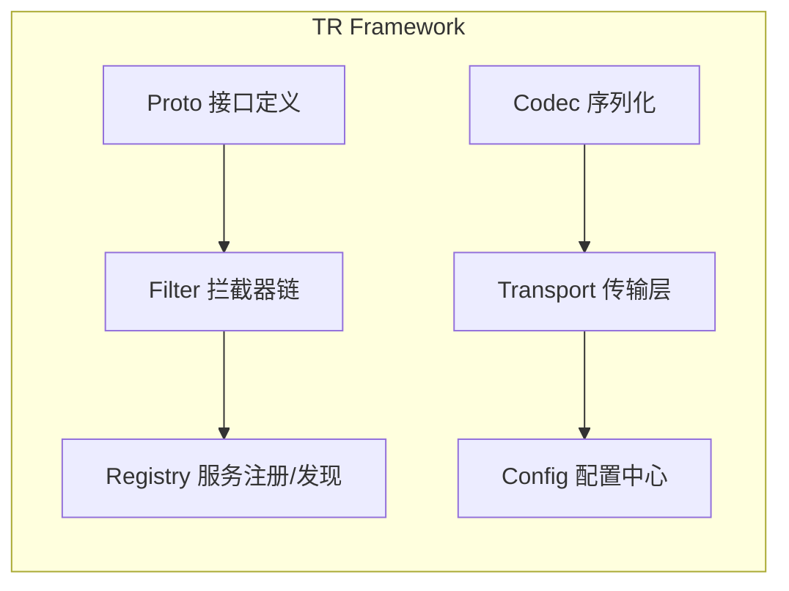
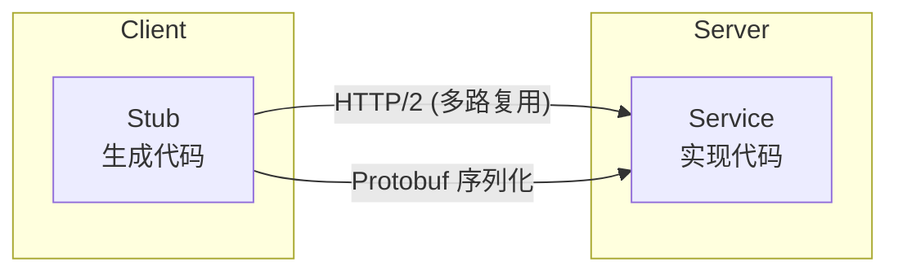
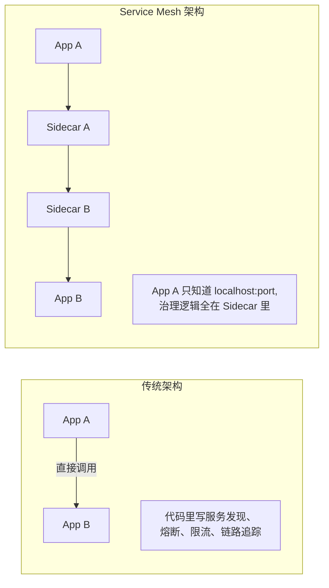
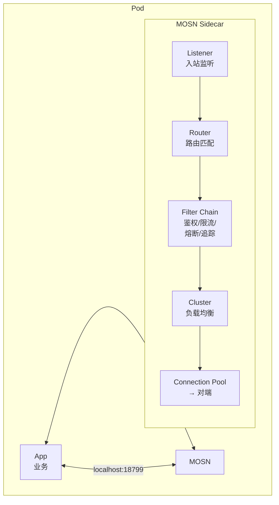
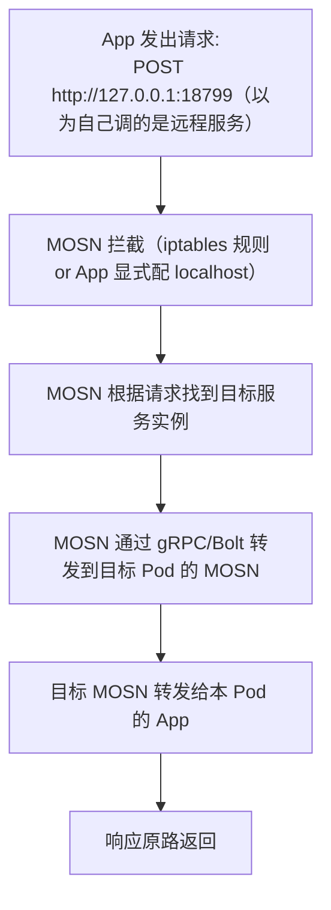

## 目录

  - [TR / gRPC / MOSN 原理详解（面试版）](#tr--grpc--mosn-原理详解面试版)
  - [1. TR — TRpc Framework](#1-tr--trpc-framework)
    - [一句话定义](#一句话定义)
    - [解决什么问题](#解决什么问题)
  - [核心概念](#核心概念)
  - [调用流程](#调用流程)
  - [TR vs Dubbo vs gRPC](#tr-vs-dubbo-vs-grpc)
  - [2. gRPC — 远程调用协议](#2-grpc--远程调用协议)
    - [核心原理](#核心原理)
  - [Protobuf — 接口定义 + 序列化](#protobuf--接口定义--序列化)
  - [Protobuf vs JSON](#protobuf-vs-json)
  - [HTTP/2 — 传输层优势](#http2--传输层优势)
  - [四种调用模式](#四种调用模式)
  - [gRPC 在 TR 中的角色](#grpc-在-tr-中的角色)
  - [3. MOSN — Service Mesh Sidecar](#3-mosn--service-mesh-sidecar)
  - [Service Mesh 是什么](#service-mesh-是什么)
  - [MOSN 的架构](#mosn-的架构)
  - [MOSN 做了什么](#mosn-做了什么)
  - [Sidecar 模式的工作原理](#sidecar-模式的工作原理)
  - [4. 三者关系：一个请求的完整链路](#4-三者关系一个请求的完整链路)
    - [生产环境（有 MOSN）](#生产环境有-mosn)
    - [开发环境（无 MOSN，走 WebGW）](#开发环境无-mosn走-webgw)
  - [为什么延迟差 4 倍](#为什么延迟差-4-倍)
  - [5. WebGW vs TR Proxy 对比](#5-webgw-vs-tr-proxy-对比)
  - [为什么不能只选一个](#为什么不能只选一个)
  - [运行时自动切换](#运行时自动切换)
  - [6. 面试高频追问](#6-面试高频追问)
- [引用](#引用)

---

> 自动生成：15 张图，由多模态模型 `doubao-seed-2.0-pro` 一次性识别转写。


### TR / gRPC / MOSN 原理详解（面试版）

---

### 1. TR — TRpc Framework

#### 一句话定义
TR（TRpc Framework）是蚂蚁集团自研的微服务 RPC 框架，类似 Dubbo/gRPC，但为蚂蚁内部基础设施深度定制。

#### 解决什么问题
微服务架构下，服务 A 调用服务 B，需要解决：
- 序列化：怎么把请求/响应转成字节流？
- 传输：走什么协议、连什么地址？
- 服务发现：服务 B 在哪？有几个实例？
- 容错：超时、重试、熔断怎么做？
- 治理：限流、灰度、链路追踪怎么接入？

---

左侧项目文件列表（部分）：
```
Project
├── ELK面试-Elasticsearch实战.md
├── Kafka与RocketMQ区别.md
├── Kimi WebBridge-vs-agent-browser-v
├── Kimi WebBridge原理面试.md
├── Multi-Agent挑战与解决方案-zfbbizrisk
├── MyBatis原理.md
├── nanobot核心架构面试.md
├── OD算法.md
├── PowerMem 记忆框架详解（面试版）.md
├── PowerMem记忆框架详解-riskcybersta
├── README.md
├── SOFABoot基座部署与SpringBoot区别.md
├── Spring Bean循环依赖.md
├── Spring Bean生命周期.md
├── SpringBoot与SOFABoot与Serverless双
├── SpringBoot自动装配原理.md
├── Spring与SpringBoot面试.md
├── SSE与Streamable HTTP对比.md
├── SSE协议对比HTTP-HTTPS-WebSocke
├── synchronized与ReentrantLock区别.md
├── TCP三次握手与四次挥手.md
├── TR-gRPC-MOSN原理详解.md  *[当前打开]*
├── 为什么有了分库还要分表.md
├── 决策引擎架构流程详解.md
├── 原生与非原生Agent区别及反思规划实
├── 可复用设计模式与架构-bizriskide.md
├── 可复用设计模式与架构-zfbbizriskagen
├── 浏览器工具原理.md
├── 系统不足与优化方案.md
├── 线程池面试.md
├── 缓存三大问题.md
├── 设计模式实战-bizriskide.md
├── 面试常见算法速查.md
├── 项目改造全景-riskcyberstaff.md
├── 项目架构深度分析-zfbbizriskagent.md
├── 风控决策系统面试问答.md
├── External Libraries
└── Scratches and Consoles
```

顶部标签栏：
```
TPS-WebSocket.md | synchronized与ReentrantLock区别.md | TR-gRPC-MOSN原理详解.md *[激活]* | TCP三次握手与四次挥手.md
```


TR 把这些都封装成统一接口，业务代码只需定义接口，不关心底层传输细节。

### 核心概念



| 概念 | 说明 |
| --- | --- |
| Proto | 用 `.proto` 文件定义接口（方法名、请求/响应结构），类似 gRPC 的 IDL |
| Codec | 序列化协议：Hessian（蚂蚁传统）、Protobuf（高效）、JSON（通用） |
| Transport | 传输协议：Bolt（蚂蚁自研 TCP 协议）、HTTP/2（gRPC 兼容） |
| Filter | 拦截器链：鉴权、限流、熔断、链路追踪、灰度路由等，按顺序执行 |

---

左侧项目文件列表同图1，顶部标签栏同图1。


### 调用流程

Client 代码：
```python
tr_post("risk-service", "QueryFacade", "queryRisk", {targetId: "123"})
```

内部流程：
1. Proto 定义找到 QueryFacade.queryRisk 的方法签名
2. 序列化请求（Hessian/Protobuf）
3. Filter 链执行（鉴权 → 限流 → 链路追踪 → ...）
4. 从 Registry 获取 risk-service 的实例列表
5. 负载均衡选一个实例
6. 通过 Transport（Bolt/HTTP2）发送请求
7. 等待响应，反序列化返回

---

### TR vs Dubbo vs gRPC

| | TR | Dubbo | gRPC |
| --- | --- | --- | --- |
| 来源 | 蚂蚁自研 | 阿里开源 | Google 开源 |
| 序列化 | Hessian/Protobuf/JSON | Hessian/Protobuf/JSON | Protobuf only |
| 传输协议 | Bolt/HTTP2 | Dubbo/HTTP/REST | HTTP/2 |
| 服务治理 | 深度集成蚂蚁基础设施 | 通用治理 | 需自行集成 |
| 适用场景 | 蚂蚁内部服务调用 | 通用 Java 微服务 | 跨语言、云原生 |

---

左侧项目文件列表同图1，顶部标签栏同图1。


### 2. gRPC — 远程调用协议

gRPC 是 Google 开源的高性能 RPC 框架，基于 HTTP/2 + Protobuf，支持双向流、多语言。

#### 核心原理



---

左侧项目文件列表同图1，顶部标签栏同图1。


### Protobuf — 接口定义 + 序列化

```protobuf
// 定义接口
service RiskService {
  rpc QueryRisk (RiskRequest) returns (RiskResponse);
}

// 定义消息结构（强类型，命名参数）
message RiskRequest {
  string target_id = 1;
  string risk_type = 2;
}

message RiskResponse {
  bool hit = 1;
  string risk_level = 2;
}
```

---

### Protobuf vs JSON

*（注：本页仅出现标题，详细对比见下一页）*

---

左侧项目文件列表同图1，顶部标签栏同图1。


| | Protobuf | JSON |
| --- | --- | --- |
| 序列化体积 | 小（二进制，字段名用数字编号） | 大（字段名是字符串重复出现） |
| 序列化速度 | 快（直接内存映射） | 慢（字符串解析） |
| 类型安全 | 强类型，编译时检查 | 弱类型，运行时才发现错误 |
| 可读性 | 不可读（二进制） | 人类可读 |

---

### HTTP/2 — 传输层优势

| 特性 | HTTP/1.1 | HTTP/2 |
| --- | --- | --- |
| 多路复用 | 每个请求一个 TCP 连接 | 一个连接上并行多个流 |
| 头部压缩 | 无 | HPACK 压缩 |
| 服务端推送 | 不支持 | 支持 |
| 二进制帧 | 文本协议 | 二进制帧 |

多路复用是关键：一个 TCP 连接上可以同时发多个请求/响应，不用排队，延迟大幅降低。

---

### 四种调用模式

| 模式 | 说明 | 场景 |
| --- | --- | --- |
| Unary | 请求→响应（最常见） | 普通 RPC 调用 |
| Server Streaming | 请求→持续流响应 | 实时日志、大结果集 |
| Client Streaming | 持续流请求→响应 | 文件上传、批量数据 |
| Bidirectional | 双向流 | 聊天、实时协作 |

---

左侧项目文件列表同图1，顶部标签栏同图1。


### gRPC 在 TR 中的角色

TR 不是 gRPC，但兼容 gRPC 协议：
- TR 的 `tr_server.py` 可以同时支持 Bolt 协议（蚂蚁内部）和 gRPC 协议（跨语言）
- 当 TR Client 通过 MOSN sidecar 调用远程服务时，走的就是 gRPC over HTTP/2
- Proto 文件是通用的：同一份 `.proto` 可以生成 TR 的 Hessian 接口，也可以生成 gRPC 的 Stub

---

### 3. MOSN — Service Mesh Sidecar

MOSN（Modular Open Smart Network）是蚂蚁开源的云原生网络代理，作为 Service Mesh 的 Sidecar，与应用部署在同一 Pod，透明拦截所有进出流量。

---

### Service Mesh 是什么



核心思想：把服务治理（鉴权、限流、熔断、路由、链路追踪）从业务代码中剥离出来，下沉到基础设施层（Sidecar），业务代码只关心业务逻辑。

---

左侧项目文件列表同图1，顶部标签栏同图1。


### MOSN 的架构



---

左侧项目文件列表同图1，顶部标签栏同图1。


### MOSN 做了什么

| 能力 | 说明 | 对业务的价值 |
| --- | --- | --- |
| 服务发现 | 从配置中心订阅服务实例列表 | 业务不需要硬编码地址 |
| 负载均衡 | 轮询/随机/加权/一致性哈希 | 请求均匀分布 |
| 路由 | 按请求头/参数路由到不同版本 | 灰度发布、A/B 测试 |
| 鉴权 | 自动携带身份信息（IAM Token 等） | 业务不需要手动认证 |
| 限流 | 单机/集群 QPS 限制 | 保护下游不被打爆 |
| 熔断 | 错误率超阈值自动断开 | 防止级联故障 |
| 链路追踪 | 自动注入/提取 Trace ID | 全链路可观测 |
| 协议转换 | Bolt ↔ HTTP/gRPC | 新老协议互通 |

---

### Sidecar 模式的工作原理
*（注：本页仅出现标题，详细说明见下一页）*

---

左侧项目文件列表同图1，顶部标签栏同图1。




关键：App 代码只知道 `127.0.0.1:18799`，完全不知道 MOSN 的存在。所有网络复杂性都被 Sidecar 透明处理。

---

### 4. 三者关系：一个请求的完整链路

#### 生产环境（有 MOSN）
```
nanobot Agent
  ↓ tr_post("risk-service", "QueryFacade", "queryRisk", args)
tr_server.py（本地常驻进程）
  ↓ MosnLayottoClient
  ↓ gRPC → 127.0.0.1:18799（MOSN Sidecar）
MOSN（本 Pod）
  ↓ 服务发现 → 找到 risk-service 实例
  ↓ 路由 → 灰度/版本匹配
  ↓ 鉴权/限流/链路追踪 → Filter Chain
  ↓ gRPC → 目标 Pod 的 MOSN
MOSN（目标 Pod）
  ↓ Bolt/Hessian → 目标服务
Risk Service（业务处理）
  ↓ 响应原路返回
~90ms
```

---

左侧项目文件列表同图1，顶部标签栏同图1。


#### 开发环境（无 MOSN，走 WebGW）
```
nanobot Agent
  ↓ webgw_post(app, facade, method, args)
WebGW HTTP 网关（webgw.alipay.com）
  ↓ IAM Token 认证
  ↓ HTTP → 转换为内部 TR 调用
  ↓ 路由到目标服务
Risk Service（业务处理）
  ↓ 响应原路返回
~400ms
```

---

### 为什么延迟差 4 倍

| 因素 | WebGW | TR Proxy + MOSN |
| --- | --- | --- |
| 协议 | HTTP/1.1 JSON | HTTP/2 Protobuf |
| 序列化 | JSON（大、慢） | Protobuf（小、快） |
| 连接 | 每次可能新建 | 长连接池复用 |
| 认证 | 每次验证 IAM Token | MOSN 自动处理 |
| 网关开销 | WebGW 解析+转发 | Sidecar 直连 |

---

### 5. WebGW vs TR Proxy 对比
*（注：本页仅出现标题，详细对比见下一页）*

---

左侧项目文件列表同图1，顶部标签栏同图1。


| | WebGW | TR Proxy |
| --- | --- | --- |
| 延迟 | ~400ms（HTTP 网关 + 认证） | ~90ms（本地代理 + gRPC 直连） |
| 认证 | 需要 IAM_TOKEN + Referer | 无需认证（MOSN 处理身份） |
| 参数 | JSON 数组位置参数（易出错） | 强类型命名参数（oneapi 生成） |
| 前提 | 网络可达 webgw 域名 | MOSN sidecar 运行中 |
| 适用 | 开发环境（本地调试） | 生产环境（服务器部署） |

---

### 为什么不能只选一个
- 只选 WebGW：生产环境 400ms 延迟不可接受，IAM Token 需周期刷新增加故障点
- 只选 TR Proxy：开发环境（本地 Mac）没有 MOSN sidecar，根本跑不起来

---

### 运行时自动切换
```python
if os.environ.get("API_MODE") == "tr":
    from tr_base import tr_post    # 生产：MOSN 直连
else:
    from webgw_base import webgw_post # 开发：WebGW 网关
```

---

### 6. 面试高频追问
*（注：本页仅出现标题，详细问答见下一页）*

---

左侧项目文件列表同图1，顶部标签栏同图1。


**Q: TR 和 Dubbo 的核心区别是什么？**
A: TR 是蚂蚁版 Dubbo，深度集成了蚂蚁基础设施（AntRegistry 服务发现、Bolt 协议、MOSN Sidecar、AntChain 鉴权）。Dubbo 是通用框架，TR 是面向蚂蚁内部的定制版。

**Q: 为什么 MOSN 要做 Sidecar 而不是 SDK？**
A: SDK 模式需要每种语言都实现一套治理逻辑（限流、熔断、链路追踪），升级时所有服务都要改代码重新部署。Sidecar 模式把治理逻辑下沉到基础设施层，业务无感知，升级 Sidecar 即可全局生效。代价是多了一跳网络延迟（~1ms）和资源开销。

**Q: gRPC 的 Protobuf 为什么比 JSON 快？**
A: 三个原因：(1) 二进制编码，字段名用数字编号代替字符串，体积小 3-10 倍；(2) 编解码是内存映射，不需要字符串解析；(3) 强类型，编译时生成代码直接赋值，不需要反射。

**Q: MOSN 的 Sidecar 怎么拦截流量的？**
A: 两种方式：(1) iptables 规则透明拦截（Istio 模式），所有进出 Pod 的流量都被重定向到 MOSN；(2) App 显式配置代理地址为 `127.0.0.1:18799`（nanobot 的 tr_server.py 就是这种方式）。

**Q: WebGW 的 IAM Token 怎么获取和刷新？**
A: 通过 SSO 登录获取，Token 有过期时间（通常几小时），过期后需要重新登录或用 Refresh Token 刷新。在 nanobot 中 Browser V4 的 `_auto_login` 就是自动完成这个流程。生产环境走 MOSN 不需要这个 Token。

**Q: tr_server.py 为什么是常驻进程而不是每次调用启动？**
A: gRPC 连接建立有开销（TCP 握手 + HTTP/2 协商 + TLS），常驻进程维护连接池可以复用长连接，避免每次调用的连接建立开销。同时常驻进程可以预热 Proto 定义、缓存服务发现结果。

---

左侧项目文件列表同图1，顶部标签栏同图1。


*（注：本页内容与图13完全一致，为同一段面试高频追问的完整展示，无新增内容）*

**Q: TR 和 Dubbo 的核心区别是什么？**
A: TR 是蚂蚁版 Dubbo，深度集成了蚂蚁基础设施（AntRegistry 服务发现、Bolt 协议、MOSN Sidecar、AntChain 鉴权）。Dubbo 是通用框架，TR 是面向蚂蚁内部的定制版。

**Q: 为什么 MOSN 要做 Sidecar 而不是 SDK？**
A: SDK 模式需要每种语言都实现一套治理逻辑（限流、熔断、链路追踪），升级时所有服务都要改代码重新部署。Sidecar 模式把治理逻辑下沉到基础设施层，业务无感知，升级 Sidecar 即可全局生效。代价是多了一跳网络延迟（~1ms）和资源开销。

**Q: gRPC 的 Protobuf 为什么比 JSON 快？**
A: 三个原因：(1) 二进制编码，字段名用数字编号代替字符串，体积小 3-10 倍；(2) 编解码是内存映射，不需要字符串解析；(3) 强类型，编译时生成代码直接赋值，不需要反射。

**Q: MOSN 的 Sidecar 怎么拦截流量的？**
A: 两种方式：(1) iptables 规则透明拦截（Istio 模式），所有进出 Pod 的流量都被重定向到 MOSN；(2) App 显式配置代理地址为 `127.0.0.1:18799`（nanobot 的 tr_server.py 就是这种方式）。

**Q: WebGW 的 IAM Token 怎么获取和刷新？**
A: 通过 SSO 登录获取，Token 有过期时间（通常几小时），过期后需要重新登录或用 Refresh Token 刷新。在 nanobot 中 Browser V4 的 `_auto_login` 就是自动完成这个流程。生产环境走 MOSN 不需要这个 Token。

**Q: tr_server.py 为什么是常驻进程而不是每次调用启动？**
A: gRPC 连接建立有开销（TCP 握手 + HTTP/2 协商 + TLS），常驻进程维护连接池可以复用长连接，避免每次调用的连接建立开销。同时常驻进程可以预热 Proto 定义、缓存服务发现结果。

---

左侧项目文件列表同图1，顶部标签栏同图1。


*（注：本页内容与图13、图14完全一致，为同一段面试高频追问的完整收尾，无新增内容）*

**Q: TR 和 Dubbo 的核心区别是什么？**
A: TR 是蚂蚁版 Dubbo，深度集成了蚂蚁基础设施（AntRegistry 服务发现、Bolt 协议、MOSN Sidecar、AntChain 鉴权）。Dubbo 是通用框架，TR 是面向蚂蚁内部的定制版。

**Q: 为什么 MOSN 要做 Sidecar 而不是 SDK？**
A: SDK 模式需要每种语言都实现一套治理逻辑（限流、熔断、链路追踪），升级时所有服务都要改代码重新部署。Sidecar 模式把治理逻辑下沉到基础设施层，业务无感知，升级 Sidecar 即可全局生效。代价是多了一跳网络延迟（~1ms）和资源开销。

**Q: gRPC 的 Protobuf 为什么比 JSON 快？**
A: 三个原因：(1) 二进制编码，字段名用数字编号代替字符串，体积小 3-10 倍；(2) 编解码是内存映射，不需要字符串解析；(3) 强类型，编译时生成代码直接赋值，不需要反射。

**Q: MOSN 的 Sidecar 怎么拦截流量的？**
A: 两种方式：(1) iptables 规则透明拦截（Istio 模式），所有进出 Pod 的流量都被重定向到 MOSN；(2) App 显式配置代理地址为 `127.0.0.1:18799`（nanobot 的 tr_server.py 就是这种方式）。

**Q: WebGW 的 IAM Token 怎么获取和刷新？**
A: 通过 SSO 登录获取，Token 有过期时间（通常几小时），过期后需要重新登录或用 Refresh Token 刷新。在 nanobot 中 Browser V4 的 `_auto_login` 就是自动完成这个流程。生产环境走 MOSN 不需要这个 Token。

**Q: tr_server.py 为什么是常驻进程而不是每次调用启动？**
A: gRPC 连接建立有开销（TCP 握手 + HTTP/2 协商 + TLS），常驻进程维护连接池可以复用长连接，避免每次调用的连接建立开销。同时常驻进程可以预热 Proto 定义、缓存服务发现结果。

---

左侧项目文件列表同图1，顶部标签栏同图1。

## 引用
