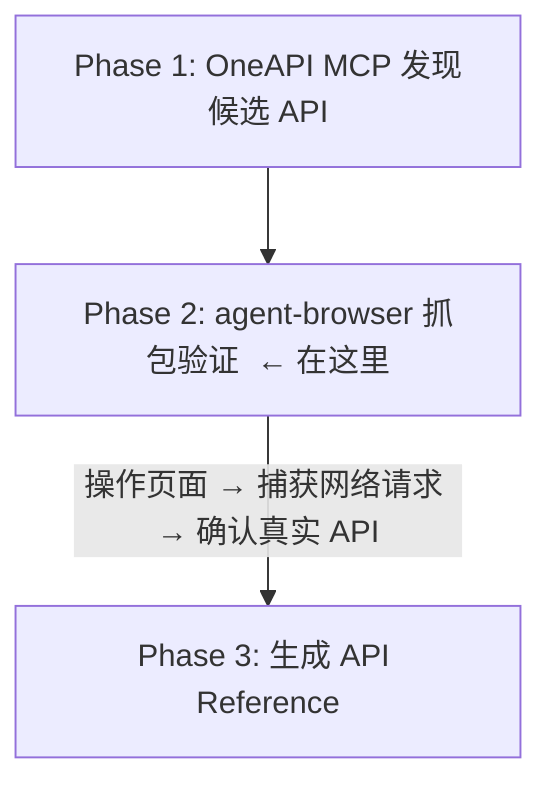

## 目录

- [一、什么是 CLI](#一什么是-cli)
- [二、agent-browser 是什么](#二agent-browser-是什么)
- [三、核心原理](#三核心原理)
  - [架构：Daemon + CDP](#架构daemon--cdp)
    - [工作流程：](#工作流程)
    - [关键设计：](#关键设计)
  - [无障碍树（Accessibility Tree）](#无障碍树accessibility-tree)
    - [为什么不用 CSS 选择器？](#为什么不用-css-选择器)
  - [网络拦截与抓包](#网络拦截与抓包)
- [四、与 Playwright/Selenium 的区别](#四与-playwrightselenium-的区别)
- [五、在 API-First Skill Builder 中的角色](#五在-api-first-skill-builder-中的角色)
  - [具体用法：](#具体用法)
    - [为什么不用 Chrome DevTools 手动抓？](#为什么不用-chrome-devtools-手动抓)
- [六、实战示例](#六实战示例)
  - [示例 1：抓包验证 API](#示例-1抓包验证-api)
  - [示例 2：页面操作 + 元素定位](#示例-2页面操作--元素定位)
  - [示例 3：HAR 录制](#示例-3har-录制)
- [七、面试高频问题](#七面试高频问题)
- [引用](#引用)

---

> 自动生成：10 张图，由多模态模型 `doubao-seed-2.0-pro` 一次性识别转写。


# agent-browser CLI 原理与实战 — riskcyberstaff

---

## 一、什么是 CLI
CLI = Command Line Interface，命令行界面。与 GUI（图形界面）相对，通过终端输入文本命令操作程序。


CLI = Command Line Interface，命令行界面。与 GUI（图形界面）相对，通过终端输入文本命令操作程序。

CLI 的特点：
- 可编程：命令可以组合、管道、脚本化，适合自动化
- 可嵌入：其他程序（如 AI Agent）可以调用 CLI 完成任务
- 无头运行：不需要显示器，适合服务器/CI 环境
- 输出结构化：JSON 输出可直接被程序解析

对比：
| | CLI | GUI | SDK/Library |
| ---- | ---- | ---- | ---- |
| 交互方式 | 命令行 | 点击/拖拽 | 代码调用 |
| 可编程性 | 高（脚本、管道） | 低 | 最高 |
| 学习成本 | 中（记命令） | 低（直觉操作） | 高（写代码） |
| 适合场景 | 自动化、CI/CD、AI Agent | 人工操作 | 深度集成 |

agent-browser 就是一个专门为 AI Agent 设计的浏览器自动化 CLI——AI 不需要写 Python 代码调用 Playwright SDK，直接在终端输入命令就能操作浏览器。

---

## 二、agent-browser 是什么


agent-browser 是一个基于 Playwright 的浏览器自动化 CLI 工具，专为 AI Agent 场景优化。

```bash
npm install -g agent-browser   # 安装
agent-browser install          # 首次使用下载 Chromium
agent-browser --version        # 查看版本（当前 0.22.0）
```

核心定位：让 AI Agent 像人一样操作浏览器——打开页面、点击、输入、截图、抓包，但通过命令行而非 Python 代码。

---

## 三、核心原理
### 架构：Daemon + CDP
```mermaid
flowchart LR
    A[AI Agent (LLM)] -->|shell 命令| B[agent-browser CLI]
    B -->|HTTP/WebSocket| C[agent-browser daemon（常驻后台进程）]
    C -->|CDP (Chrome DevTools Protocol)| D[Chromium 浏览器实例]
```


#### 工作流程：
1. 首次命令启动 daemon 进程，daemon 启动 Chromium 浏览器
2. 后续命令通过 HTTP 与 daemon 通信，daemon 通过 CDP 控制浏览器
3. 命令执行完，CLI 退出，daemon 和浏览器保持运行（会话保持）
4. 下一条命令复用同一个浏览器实例，直到 `agent-browser close`

#### 关键设计：
- 会话保持：命令之间浏览器不关闭，登录状态、Cookie、页面状态全部保留
- 命令链式调用：`agent-browser open url && agent-browser click @e1 && agent-browser snapshot`
- CDP 直连：`--cdp 9222` 可连接已有 Chrome 实例（如 BUC 登录后的浏览器）

---

### 无障碍树（Accessibility Tree）
```bash
agent-browser snapshot -i
```
输出页面的无障碍树，每个可交互元素标注 `@e1`、`@e2` 等引用 ID：
```
button "搜索" [@e1]
textbox "请输入关键词" [@e2]
link "帮助" [@e3]
```

AI Agent 不需要解析 HTML/CSS，直接用 `@e1`、`@e2` 操作元素：
```bash
agent-browser fill @e2 "风控策略"
agent-browser click @e1
```

#### 为什么不用 CSS 选择器？


- CSS 选择器依赖页面结构（class、id），前端改版就失效
- `@ref` 基于无障碍树，是语义化的，更稳定
- AI 理解 `@e1` 比 `div.container > form input#search-box` 简单得多

---

### 网络拦截与抓包
```bash
# 开始录制 HAR
agent-browser network har start

# 操作页面（触发 API 请求）
agent-browser open https://risk.alipay.com/strategy/list
agent-browser click @e1

# 查看捕获的请求
agent-browser network requests --type xhr,fetch --method POST

# 查看某个请求的完整详情（含 request body 和 response body）
agent-browser network request 1234.5

# 停止录制，导出 HAR 文件
agent-browser network har stop ./capture.har
```

这是 API-First Skill Builder Phase 2 的核心能力——在页面上操作的同时，捕获所有 XHR/Fetch 请求，拿到真实的 API URL、Headers、Request Body、Response Body。

---

## 四、与 Playwright/Selenium 的区别


| | agent-browser | Playwright (Python) | Selenium |
| ---- | ---- | ---- | ---- |
| 交互方式 | CLI 命令 | Python SDK | 多语言 SDK |
| 目标用户 | AI Agent | 开发者写测试 | 开发者写测试 |
| 会话管理 | 自动 daemon，命令间保持 | 代码控制，需手动管理 | 代码控制，需手动管理 |
| 元素定位 | `@ref`（无障碍树） | CSS/XPath/role | CSS/XPath |
| 抓包 | 内置 `network` 命令 | 需写代码监听 | 需写代码监听 |
| 输出 | 文本/JSON（AI 友好） | Python 对象 | Python 对象 |
| 登录状态 | `--profile` 持久化 | 需手动保存 cookie | 需手动保存 cookie |
| CDP 直连 | `--cdp` 原生支持 | `connect_over_cdp()` | 需配置 |

核心差异：agent-browser 把 Playwright 的能力包装成 CLI，让 AI Agent 不需要写代码就能操作浏览器。每条命令都是独立的 shell 调用，AI 只需要"想"要做什么，然后把命令拼出来。

---

## 五、在 API-First Skill Builder 中的角色




### 具体用法：
1. `agent-browser open` 打开目标页面（已登录状态）
2. `agent-browser network har start` 开始录制
3. 在页面上执行 DOM 操作（点击、搜索、提交表单）
4. `agent-browser network requests --type xhr,fetch --method POST` 查看捕获的 API
5. `agent-browser network request <id>` 查看完整的 request/response body
6. `agent-browser network har stop` 导出 HAR 文件

#### 为什么不用 Chrome DevTools 手动抓？
- AI Agent 无法手动操作 DevTools 面板
- agent-browser 的输出是结构化 JSON，AI 可以直接解析
- 命令可编程、可重复，适合自动化流程

---

## 六、实战示例


### 示例 1：抓包验证 API
```bash
# 1. 打开页面（使用已有 profile 保持登录状态）
agent-browser --profile ~/.risk-app open https://risk.alipay.com/strategy/list

# 2. 等待页面加载
agent-browser wait --load networkidle

# 3. 开始录制网络请求
agent-browser network har start

# 4. 操作页面：搜索策略包
agent-browser snapshot -i                     # 先看有哪些可交互元素
agent-browser fill @e2 "测试策略包"            # 在搜索框输入
agent-browser click @e1                       # 点击搜索按钮
agent-browser wait --load networkidle         # 等待结果加载

# 5. 查看捕获的 POST 请求（API 调用）
agent-browser network requests --type xhr,fetch --method POST --filter "strategy"

# 输出示例：
# POST https://webgw.alipay.com/zfbpunishcenter/.../AccessEventFacade/queryByPage [200]
# POST https://webgw.alipay.com/zfbpunishcenter/.../AccessEventFacade/queryFeatures [200]

# 6. 查看具体请求的完整详情
agent-browser network request 1.2 --json

# 输出包含：url, method, headers, request body, response body
# 这就是 Phase 2 需要的"带真实 Body 的已验证 API"

# 7. 停止录制
agent-browser network har stop ./strategy-api.har
```


### 示例 2：页面操作 + 元素定位
```bash
# 获取页面的无障碍树（只看可交互元素）
agent-browser snapshot -i

# 输出：
# navigation "主导航"
#   link "策略管理" [@e1]
#   link "事件配置" [@e2]
# main
#   button "新建策略包" [@e3]
#   textbox "搜索策略包名称" [@e4]
#   button "搜索" [@e5]
#   table "策略包列表"
#     row "测试策略包 v1.0 EDIT 张三 2026-04-01" [@e6]

# 点击"新建策略包"
agent-browser click @e3
agent-browser wait --load networkidle

# 填写表单
agent-browser fill @e10 "新策略包"
agent-browser select @e11 "EDIT"
agent-browser click @e12 # 保存
```

---

### 示例 3：HAR 录制


HAR（HTTP Archive）是浏览器网络请求的标准导出格式
# 可以用 Chrome DevTools、Fiddler 等工具打开分析

```bash
agent-browser network har start
# ... 执行一系列操作 ...
agent-browser network har stop ./full-session.har
```

# HAR 文件包含：
# - 所有请求的 URL、方法、Headers、Body
# - 所有响应的状态码、Headers、Body
# - 请求时间线（DNS、连接、TTFB、下载时间）
# - 适合后续离线分析

---

## 七、面试高频问题
**Q: agent-browser 和 Playwright 有什么区别？**
A: agent-browser 底层就是 Playwright，但把它包装成了 CLI。Playwright 是 Python/JS SDK，需要写代码；agent-browser 是命令行工具，AI Agent 直接拼命令就能操作浏览器。核心差异是交互方式——SDK 给开发者用，CLI 给 AI Agent 用。另外 agent-browser 的 `@ref` 元素定位基于无障碍树，比 CSS 选择器更稳定，前端改版不容易失效。

**Q: 为什么 API-First Skill Builder 需要浏览器抓包？OneAPI 不够吗？**
A: OneAPI 记录的是 Java DTO 字段，经过序列化/网关代理后实际传输的字段名可能不同（驼峰 vs 下划线、展平 vs 嵌套、位置参数顺序）。唯一可信来源是浏览器实际发出的请求。所以 Phase 1 用 OneAPI 发现候选，Phase 2 用 agent-browser 抓包验证真实 Body——输入字段必须溯源到抓包 JSON，不能从 OneAPI 元数据推断。

**Q: CDP 是什么？为什么 agent-browser 能连已有浏览器？**
A: CDP = Chrome DevTools Protocol，Chrome 浏览器内置的调试协议。Chrome 启动时加 `--remote-debugging-port=9222` 就会开放 CDP 端口。agent-browser 的 `--cdp 9222` 就是连接到这个端口，直接控制已有浏览器实例。这在 API-First 场景下特别有用——用户已经在浏览器里登录了 BUC 账号，agent-browser 直接连过去就能用，不需要重新登录。

**Q: daemon 模式的好处是什么？**
A: 浏览器启动慢（1-3 秒），如果每条命令都启动新浏览器，10 条命令就要 10-30 秒。daemon 模式下浏

## 引用
