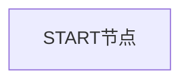
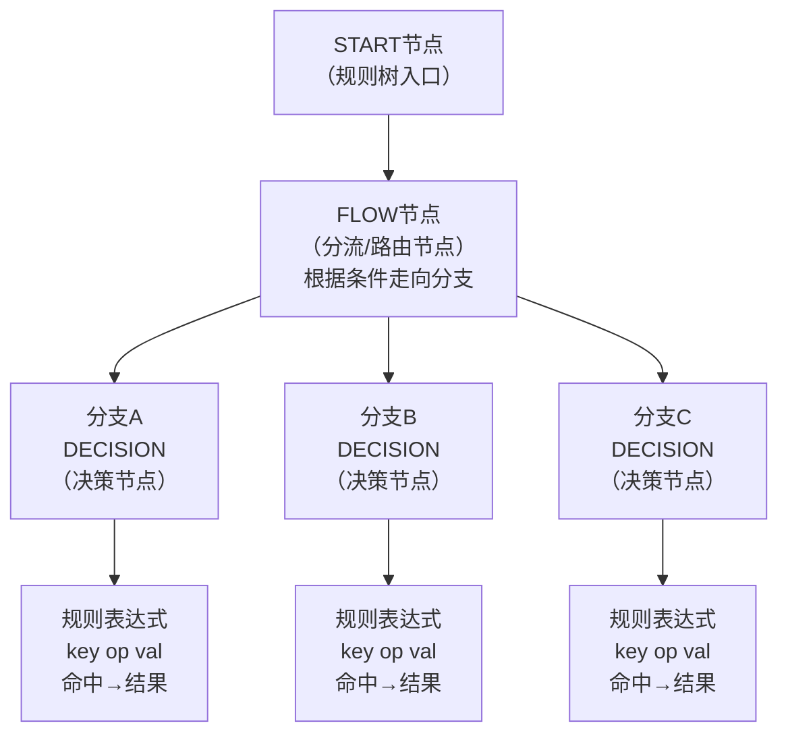
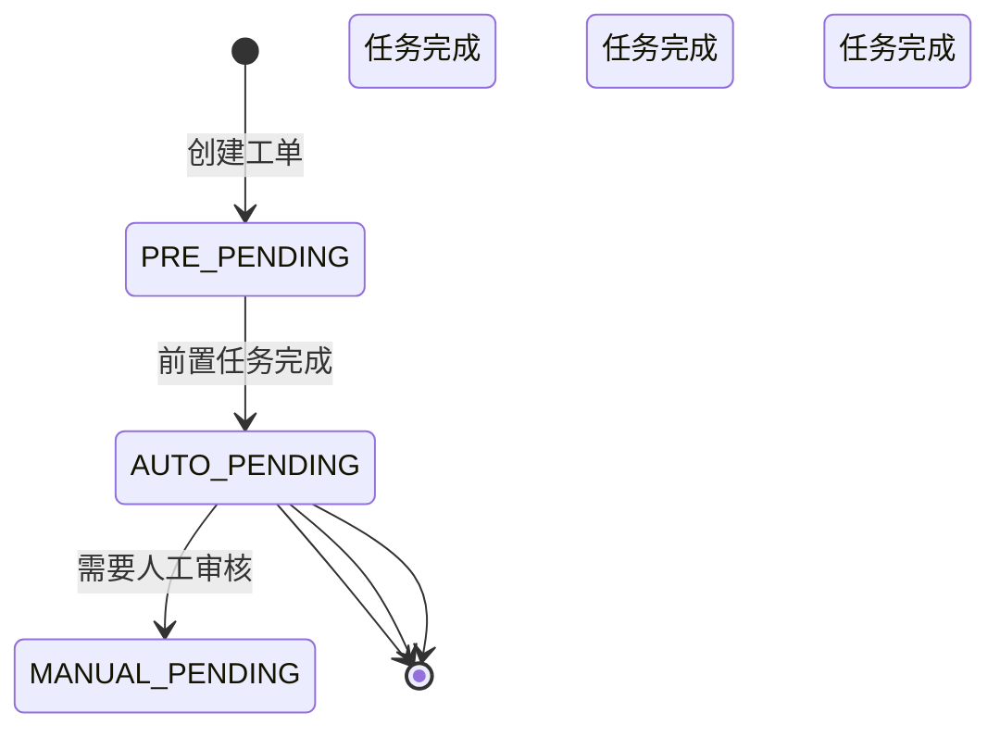
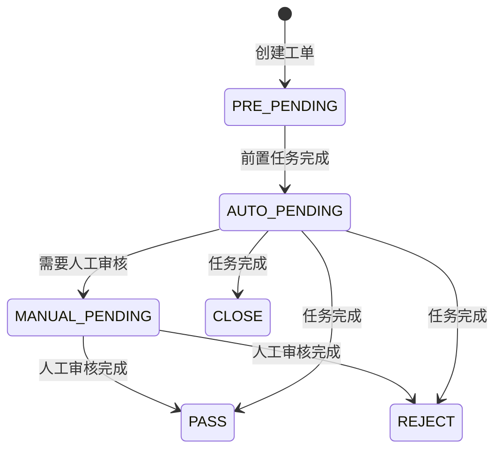
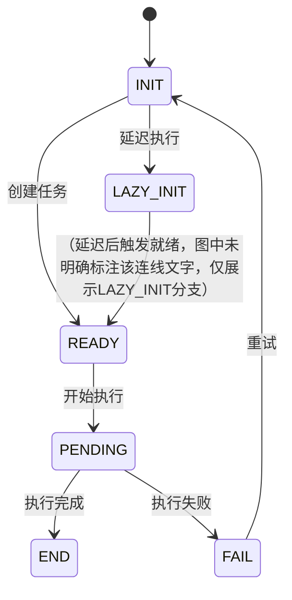

## 目录

- [一、整体架构流程图](#一整体架构流程图)
- [一、整体架构流程图（续）](#一整体架构流程图续)
- [二、核心组件详解](#二核心组件详解)
  - [1. 决策入口层 (DecisionFacadeImpl)](#1-决策入口层-decisionfacadeimpl)
- [二、核心组件详解（续）](#二核心组件详解续)
  - [2. 风险检查组件 (RiskCheckComponentImpl)](#2-风险检查组件-riskcheckcomponentimpl)
    - [四种执行模式](#四种执行模式)
    - [核心路由逻辑](#核心路由逻辑)
    - [核心路由逻辑（续）](#核心路由逻辑续)
    - [同步检测流程](#同步检测流程)
    - [同步检测流程（续）](#同步检测流程续)
  - [3. 任务处理器引擎 (TaskProcessorEngineImpl)](#3-任务处理器引擎-taskprocessorengineimpl)
    - [任务执行核心逻辑](#任务执行核心逻辑)
    - [任务执行核心逻辑（续）](#任务执行核心逻辑续)
    - [异步回调处理](#异步回调处理)
    - [异步回调处理（续）](#异步回调处理续)
  - [4. 决策计算引擎 (DecisionComputeEngineImpl)](#4-决策计算引擎-decisioncomputeengineimpl)
    - [决策计算入口](#决策计算入口)
    - [规则节点递归计算](#规则节点递归计算)
  - [4. 决策计算引擎 (DecisionComputeEngineImpl)（续）](#4-决策计算引擎-decisioncomputeengineimpl续)
    - [决策计算入口（续）](#决策计算入口续)
    - [规则节点递归计算（续）](#规则节点递归计算续)
- [三、决策规则树结构](#三决策规则树结构)
    - [规则表达式示例](#规则表达式示例)
- [三、决策规则树结构（续）](#三决策规则树结构续)
    - [节点类型说明](#节点类型说明)
- [四、任务处理器工厂模式](#四任务处理器工厂模式)
  - [处理器类型分类](#处理器类型分类)
  - [处理器类型分类（承接图19）](#处理器类型分类承接图19)
  - [处理器接口定义](#处理器接口定义)
- [五、状态流转](#五状态流转)
  - [EventOrder（工单）状态流转](#eventorder工单状态流转)
  - [ProcessTask（任务）状态流转](#processtask任务状态流转)
  - [状态枚举定义](#状态枚举定义)
- [六、性能优化设计](#六性能优化设计)
  - [按需执行机制](#按需执行机制)
- [七、关键文件索引](#七关键文件索引)
- [七、关键文件索引（承接图27）](#七关键文件索引承接图27)
- [八、总结](#八总结)
- [引用](#引用)

---

> 自动生成：29 张图，由多模态模型 `doubao-seed-2.0-pro` 一次性识别转写。

---

## 一、整体架构流程图

```mermaid
flowchart TD
    A[决策请求入口<br>DecisionFacade.submitDecision()] --> B[...]
```

## 一、整体架构流程图（续）

```mermaid
flowchart TD
    A[同步检测<br>syncCheck]
    B[异步检测<br>submitCheck<br>Core]
    C[按需执行<br>syncOnDemand]
    A & B & C --> D[RiskCheckComponent<br>submitCheckCore()]
    subgraph RiskCheckComponent
        D1[1. 幂等判断（outBizNo + eventCode）]
        D2[2. 生成EventOrder（工单）]
        D3[3. 创建前置任务（ProcessTask - CHECK_EVENT_PRE）]
        D4[4. 创建检测任务（ProcessTask - RISK_CHECK）]
        D5[5. 事务性保存工单和任务]
    end
    D --> E[TaskProcessorEngine<br>任务执行引擎]
    subgraph TaskProcessorEngine
        E1[1. 从工厂获取处理器（TaskProcessorFactory）]
        E2[2. 执行前置处理器（PreProcessor）]
        E3[3. 执行检测处理器（CheckItemProcessor）]
        E4[4. 异步回调处理（notifyResult）]
        E5[5. 后置处理（after）]
    end
    E --> F[AutoCheckStrategyComponent<br>decisionForOrder()]
```

左侧项目文件列表同图1。

```mermaid
flowchart TD
    A[AutoCheckStrategyComponent<br>decisionForOrder()] --> B[调用 DecisionComputeEngine.computeEventOrder()<br>执行决策规则计算]
    B --> C[DecisionComputeEngine<br>决策规则计算引擎]
    subgraph DecisionComputeEngine
        C1[1. 获取决策规则树（DecisionStrategyRuleNode）]
        C2[2. 构建特征值池（FeatureItemParamMap）]
        C3[3. 递归计算规则节点（computeNest）]
        C3_1[FLOW节点：分流节点，根据条件走向不同分支]
        C3_2[DECISION节点：决策节点，计算命中结果]
        C3_3[PARALLEL节点：并行节点，同时计算多个分支]
        C4[4. 汇总决策结果（resultCode, hitValueList）]
    end
    C --> D[决策结果]
    subgraph 决策结果
        D1[resultCode: PASS / REJECT / CC / CLOSE]
        D2[hitValueList: 命中的风险类型列表]
        D3[ruleNodeComputeResultMap: 各节点计算结果]
    end
```

左侧项目文件列表同图1。

## 二、核心组件详解

### 1. 决策入口层 (DecisionFacadeImpl)
文件位置：`app/biz/service/impl/src/main/java/com/alipay/bizriskide/biz/service/facade/impl/DecisionFacadeImpl.java`

```java
@Override
public Result<OrderDecisionResult> submitDecision(DecisionRequest request, BizContext context) {
    return serviceTemplate.execute(new ServiceCallback<OrderDecisionResult>() {
        @Override
        public void checkParams() {
            // 参数校验
            BaseCheckUtil.checkEmptyObject(request, context);
            ParamCheckUtil.check(request);
            ParamCheckUtil.check(context);
        }

        @Override
        public OrderDecisionResult executeService() {
            return decisionComponent.submitDecision(request, context);
        }

        @Override
        public String getServiceDesc() {
            return "DecisionFacadeImpl.submitDecision";
        }
    });
}
```

设计要点：

左侧项目文件列表同图1。

## 二、核心组件详解（续）

设计要点：
- 使用 `ServiceTemplate` 模板模式，统一处理参数校验、异常处理、日志记录
- 通过 `@RpcProvider` 注解暴露为 RPC 服务

---

### 2. 风险检查组件 (RiskCheckComponentImpl)
文件位置：`app/biz/shared/src/main/java/com/alipay/bizriskide/biz/shared/component/impl/RiskCheckComponentImpl.java`

#### 四种执行模式

| 模式     | 触发条件                | 执行方式                         | 适用场景                 |
|----------|-------------------------|----------------------------------|--------------------------|
| 同步检测 | `isSync(event)`         | 同步执行所有任务，立即返回结果   | 简单规则、低延迟要求     |
| 异步检测 | 默认模式                | 创建任务后返回CC，后台执行       | 复杂规则、高吞吐场景     |
| 同步按需 | `isSyncOnDemand()`      | 按需生成任务，同步执行           | 动态规则、中等复杂度     |
| 蓄洪模式 | `IS_PRE_POOL=true`      | 先入预处理池，定时批量处理       | 流量削峰场景             |

#### 核心路由逻辑

```java
@Override
public CheckResult submitCheck(CheckRequest request, BizContext context) {
    Event event = eventComponent.queryByCode(request.getEventCode());

    // 1. 事件降级判断
    if (isDemotion(event)) {
        return convertCheckPassResult(request);
    }
```

左侧项目文件列表同图1。

#### 核心路由逻辑（续）

```java
    // 2. 同步事件判断
    if (isSync(event)) {
        return syncCheck(request, event, tenantId);
    }

    DecisionStrategy decisionStrategy = getDecisionStrategy(event.getEventId());

    // 3. 同步按需执行判断
    if (isSyncOnDemand(decisionStrategy)) {
        return syncCheckOnDemand(request, event, tenantId, decisionStrategy);
    }

    // 4. 蓄洪模式判断
    if (isPrePool(event)) {
        createPrePool(request, event, tenantId, decisionStrategy);
        return contractCCResult(request.getOutBizNo(), event);
    }

    // 5. 默认异步检测
    return submitCheckCore(request, event, null, tenantId, decisionStrategy);
}
```

#### 同步检测流程

```java
private CheckResult syncCheck(CheckRequest request, Event event, String tenantId) {
    try {
```

左侧项目文件列表同图1。

#### 同步检测流程（续）

```java
        eventOrderBusService.useThreadLocal();
        EventOrder eventOrder = genEventOrder(request, event, EventOrderStatusEnum.PRE_PENDING, null, tenantId, null);
        // 保存工单
        saveEventOrder(eventOrder);

        // 创建并执行前置任务
        List<ProcessTask> preProcessTaskList = createCheckEventTaskEngine.createPreProcessTask(eventOrder);
        processTaskList(preProcessTaskList);

        // 创建并执行检测任务
        List<ProcessTask> processTaskList = createCheckEventTaskEngine.createCheckItemProcessTask(eventOrder, new Invoke...);
        processTaskList(processTaskList);

        // 决策计算
        DecisionComputeResultInfo decisionComputeResultInfo = autoCheckStrategyComponent.decisionForOrder(eventOrder, ...);
        eventOrder.setDecisionComputeResult(decisionComputeResultInfo.getDecisionComputeResult());

        // 构建返回结果
        CheckResult checkResult = riskCheckResultComponent.buildCheckResult(eventOrder, event);
        return checkResult;
    } finally {
        eventOrderBusService.clearThreadLocal();
    }
}
```

左侧项目文件列表同图1。

### 3. 任务处理器引擎 (TaskProcessorEngineImpl)
文件位置：
`app/biz/shared/src/main/java/com/alipay/bizriskide/biz/shared/component/decision/engine/TaskProcessorEngineImpl.java`

#### 任务执行核心逻辑

```java
public void execute(String processTaskId) {
    ProcessTask processTask = eventOrderBusService.queryTaskById(processTaskId);

    // 1. 执行次数校验（最多10次）
    if (!isPassCheckByMaxTimes(processTask)) {
        processResult.setProcessTaskStatus(ProcessTaskStatusEnum.FAIL.getCode());
        return;
    }

    // 2. 挂起检查
    if (isSuspend(processTask.getProcessor())) {
        processResult.setProcessTaskStatus(ProcessTaskStatusEnum.END.getCode());
        return;
    }

    // 3. 跳过检查
    if (isSkip(processTask)) {
        processResult.setProcessTaskStatus(ProcessTaskStatusEnum.END.getCode());
        return;
    }

    // 4. 获取处理器并执行
    TaskProcessorInterface processor = taskProcessorFactory.getProcessorByCode(processTask.getProcessor());
    saveExeTimes(processTaskId); // 记录执行次数
    processResult = invokeExecute(processor, processTask);
```

左侧项目文件列表同图1。

#### 任务执行核心逻辑（续）

```java
    // 5. 更新任务状态
    eventOrderBusService.updateProcessTaskByResult(processResult, processTask);

    // 6. 后置处理
    transactionAfter(processTaskId, true);
}
```

---

#### 异步回调处理

```java
public void notifyResult(Object obj, String processTaskId) {
    ProcessTask processTask = processTaskComponent.queryById(processTaskId);

    // 1. 状态校验（必须是PENDING状态）
    if (!checkErRiskProcessTask(processTask, ProcessTaskStatusEnum.PENDING, processTaskId)) {
        return;
    }

    // 2. 获取处理器
    TaskProcessorInterface processor = taskProcessorFactory.getProcessorByCode(processTask.getProcessor());

    // 3. 调用处理器的asyncResultConvert方法转换结果
    ProcessResult processResult = invokeAsyncResultConvert(processor, obj, processTask);

    // 4. 更新任务
    processTaskComponent.updateProcessTask(processResult);
```

左侧项目文件列表同图1。

#### 异步回调处理（续）

```java
    // 5. 后置处理
    if (updateCount > 0) {
        transactionAfter(processTaskId, true);
    }
}
```

---

### 4. 决策计算引擎 (DecisionComputeEngineImpl)
文件位置：
`app/biz/shared/src/main/java/com/alipay/bizriskide/biz/shared/component/decision/engine/DecisionComputeEngineImpl.java`

#### 决策计算入口

```java
@Override
public DecisionComputeResultInfo computeEventOrder(EventOrder eventOrder, InvokeOnDemandContext invokeOnDemandContext) {
    // 1. 获取决策规则树
    DecisionStrategyRuleNode ruleNode = decisionStrategyRuleComponent.getByCache(
            eventOrder.getStrategyId(), eventOrder.getStrategyVersion());

    // 2. 获取工单的所有特征
    Map<String, FeatureItemParam> featureItemParamMap = getFeatureItemMap(eventOrder);

    // 3. 获取特征定义
    Map<String, EventFeature> featureDefineMap = getFeatureDefine(eventOrder);

    // 4. 决策计算
    DecisionComputeResult decisionComputeResult = compute(ruleNode, featureItemParamMap, featureDefineMap, customDecisi...);

    // 5. 仿真测试计算
    Map<String, DecisionComputeResult> simulationTestComputeResultMap = computeSimulationTest(eventOrder, featureItemPa...);

    DecisionComputeResultInfo resultInfo = new DecisionComputeResultInfo();
    resultInfo.setDecisionComputeResult(decisionComputeResult);
    resultInfo.setSimulationTestComputeResultMap(simulationTestComputeResultMap);

    return resultInfo;
}
```

#### 规则节点递归计算

左侧项目文件列表同图1。

### 4. 决策计算引擎 (DecisionComputeEngineImpl)（续）
#### 决策计算入口（续）

```java
    return resultInfo;
}
```

```java
private void computeNest(DecisionStrategyRuleNode ruleNode,
                         Map<String, FeatureItemParam> featureItemParamMap,
                         Map<String, EventFeature> featureDefineMap,
                         Map<String, RuleNodeComputeResult> ruleNodeComputeResultMap,
                         Integer strategyVersion,
                         InvokeOnDemandContext invokeOnDemandContext) {
    // 参数检查
    if (!nestCheck(ruleNode, featureItemParamMap, featureDefineMap, ruleNodeComputeResultMap)) {
        return;
    }

    // 计算当前节点的所有条件表达式
    Map<String, BooleanExt<String>> expressionResultMap = computeExpressions(
            ruleNode.getExprssionList(), featureItemParamMap, featureDefineMap, invokeOnDemandContext);

    // 如果当前节点存在未完成的处理任务，不再往下执行
    if (!invokeOnDemandContext.getCurrentCodeFinishStatus()) {
        return;
    }

    // 初始化节点计算结果
    RuleNodeComputeResult ruleNodeComputeResult = initRuleNodeComputeResult(ruleNode, expressionResultMap, ruleNodeCompute...);

    // 根据节点类型执行不同逻辑
    if (RuleNodeTypeEnum.FLOW.equals(ruleNode.getRuleNodeType())) {
```

左侧项目文件列表同图1。

#### 规则节点递归计算（续）

```java
        // =========== 分流节点 ===========
        boolean isHitRelation = false;
        for (DecisionExpressionRelation relation : ruleNode.getExpressionRelationList()) {
            Boolean result = ExpressionRelationUtil.compute(relation.getRelationStr(), expressionHitResultMap);
            if (result) {
                isHitRelation = true;
                ruleNodeComputeResult.getHitExpressionRelations().add(relation);
                // 递归计算下一个节点
                DecisionStrategyRuleNode nextRuleNode = getFlowNodeHitRelationRuleNode(relation, ruleNode.getNextNodes());
                if (nextRuleNode != null) {
                    computeNest(nextRuleNode, featureItemParamMap, featureDefineMap, ruleNodeComputeResultMap, strategyVe...);
```

左侧项目文件列表同图1。

```java
                }
            }
        }
        // 没有命中任何关系，走兜底节点
        if (!isHitRelation && defaultAction != null) {
            DecisionStrategyRuleNode defaultNextRuleNode = getFlowNodeHitRelationRuleNode(defaultAction, ruleNode.getNe...);
            if (defaultNextRuleNode != null) {
                computeNest(defaultNextRuleNode, featureItemParamMap, featureDefineMap, ruleNodeComputeResultMap, strate...);
            }
        }
    } else if (RuleNodeTypeEnum.DECISION.equals(ruleNode.getRuleNodeType())) {
        // =========== 决策节点 ===========
        ruleNodeComputeResult.setHitValueList(parseHitValueListFromExpressionResult(expressionResultMap));
        boolean isHitRelation = false;
        List<String> hitValueList = new ArrayList<>();

        for (DecisionExpressionRelation relation : ruleNode.getExpressionRelationList()) {
            Boolean result = ExpressionRelationUtil.compute(relation.getRelationStr(), expressionHitResultMap);
            if (result) {
                isHitRelation = true;
                ruleNodeComputeResult.getHitExpressionRelations().add(relation);
```

左侧项目文件列表同图1。

```java
                if (!CollectionUtils.isEmpty(relation.getHitValueSet())) {
                    hitValueList.addAll(relation.getHitValueSet());
                }
            }
        }
        if (isHitRelation) {
            invokeOnDemandContext.updateCurrentHitValueList(hitValueList);
        }

        // 没有命中任何关系，走兜底action
        if (!isHitRelation && defaultAction != null) {
            ruleNodeComputeResult.getHitExpressionRelations().add(defaultAction);
        }

        // 继续计算下一个节点
        if (ListUtil.isNotBlank(ruleNode.getNextNodes())) {
            computeNest(ruleNode.getNextNodes().get(0), featureItemParamMap, featureDefineMap, ruleNodeComputeResultMap);
        }
    } else if (RuleNodeTypeEnum.PARALLEL.equals(ruleNode.getRuleNodeType())) {
        // =========== 并行节点 ===========
        if (StringUtils.equalsIgnoreCase("START", ruleNode.getRuleNodePosition())) {
            // 并行开始节点：同时计算所有子节点
```

左侧项目文件列表同图1。

```java
            for (DecisionStrategyRuleNode childNode : ruleNode.getNextNodes()) {
                computeNest(childNode, featureItemParamMap, featureDefineMap, ruleNodeComputeResultMap, strategyVersion);
            }
        } else if (StringUtils.equalsIgnoreCase("END", ruleNode.getRuleNodePosition())) {
            // 并行结束节点：等待所有父节点执行完成
            Set<String> finishedParentRuleIdSet = new HashSet<>();
            for (String parentRuleNodeId : ruleNode.getParentRuleNodeIdList()) {
                if (null != ruleNodeComputeResultMap.get(parentRuleNodeId)) {
                    finishedParentRuleIdSet.add(parentRuleNodeId);
                }
            }
            // 所有父节点都执行完成，继续执行下一个节点
            if (ruleNode.getStartRuleNodeSize() == finishedParentRuleIdSet.size()) {
                if (ListUtil.isNotBlank(ruleNode.getNextNodes())) {
                    computeNest(ruleNode.getNextNodes().get(0), featureItemParamMap, featureDefineMap, ruleNodeComputeResult...);
                }
            }
        }
    }
}
```

---

## 三、决策规则树结构



左侧项目文件列表同图1。



#### 规则表达式示例

左侧项目文件列表同图1。

## 三、决策规则树结构（续）

- 表达式：`age > 18 && risk_score > 80`
- 操作符：`>`, `<`, `==`, `!=`, `>=`, `<=`, `contains`, `in`, `not_in`
- 结果：`PASS / REJECT / CC / CLOSE`

---

#### 节点类型说明

| 节点类型   | 代码           | 功能                     | 执行逻辑                                               |
|------------|----------------|--------------------------|--------------------------------------------------------|
| FLOW       | 流量分流节点   | 根据条件走向不同分支     | 命中哪个关系表达式，就走向哪个分支                     |
| DECISION   | 决策节点       | 计算命中结果             | 计算所有表达式，汇总命中的结果                         |
| PARALLEL   | 并行节点       | 同时计算多个分支         | START节点触发所有分支，END节点等待所有分支完成         |

---

## 四、任务处理器工厂模式

文件位置：
`app/biz/shared/src/main/java/com/alipay/bizriskide/biz/shared/component/decision/factory/TaskProcessorFactory.java`

系统通过工厂模式动态获取处理器：

```java
@Component
public class TaskProcessorFactory implements InitializingBean {
    private Map<String, TaskProcessorInterface> processorMap = new HashMap<>();

    @Override
    public void afterPropertiesSet() {
```

左侧项目文件列表同图1。

系统通过工厂模式动态获取处理器：
```java
@Component
public class TaskProcessorFactory implements InitializingBean {
    private Map<String, TaskProcessorInterface> processorMap = new HashMap<>();

    @Override
    public void afterPropertiesSet() {
        // 注册所有处理器
        processorMap.put("BuildItemFeaturePreProcessor", buildItemFeaturePreProcessor);
        processorMap.put("GriskCheckItemProcessor", griskCheckItemProcessor);
        processorMap.put("InfoSecCheckItemProcessor", infoSecCheckItemProcessor);
        processorMap.put("BrcCheckItemProcessor", brcCheckItemProcessor);
        processorMap.put("AppxriskCheckItemProcessor", appxriskCheckItemProcessor);
        // ... 100+ 处理器
    }

    public TaskProcessorInterface getProcessorByCode(String code) {
        return processorMap.get(code);
    }
}
```

### 处理器类型分类

| 类型         | 前置处理器（PreProcessor）                | 检测处理器（CheckItemProcessor） | 后置处理器（AfterProcessor）       |
|--------------|-------------------------------------------|----------------------------------|------------------------------------|
| 功能         | 数据准备、特征提取                        | 风险检测、规则执行               | 结果处理、消息通知                 |
| 执行顺序     | 先执行                                    | 后执行                           | 最后执行                           |
| 示例         | BuildItemFeaturePreProcessor              | GriskCheckItemProcessor          | （该行列示例内容为InvokePunishAfterProcessor，图中该行对应示例列未完全展示） |
| 数量         | ~50个                                     | ~80个                            | ~20个                              |

*左侧文件目录（仅展示当前打开文档上下文，非文档内容）：
`M↓ 决策引擎架构流程详解.md`
底部状态栏：`preview > M↓ 决策引擎架构流程详解.md`
右侧状态栏：`1:1 LF UTF-8 Ready result:0 4 spaces`*

### 处理器类型分类（承接图19）

| 类型         | 前置处理器（PreProcessor）                | 检测处理器（CheckItemProcessor） | 后置处理器（AfterProcessor）       |
|--------------|-------------------------------------------|----------------------------------|------------------------------------|
| 功能         | 数据准备、特征提取                        | 风险检测、规则执行               | 结果处理、消息通知                 |
| 执行顺序     | 先执行                                    | 后执行                           | 最后执行                           |
| 示例         | BuildItemFeaturePreProcessor              | GriskCheckItemProcessor          | InvokePunishAfterProcessor         |
| 数量         | ~50个                                     | ~80个                            | ~20个                              |

---

### 处理器接口定义
```java
// TaskProcessorInterface接口方法定义
// 任务执行
[返回值类型] execute(ProcessParam processParam, Map<String, Object> context);
// 结果转换
[返回值类型] asyncResultConvert(Object result, ProcessParam processParam, ProcessResult processResult, Map<String, Object> context);
// 后置处理
[返回值类型] after(ProcessParam processParam, ProcessResult processResult, Map<String, Object> context);
// 催审
BooleanExt urge(ProcessParam processParam, Map<String, Object> context);
```
*（注：接口的返回值类型在图中被截断，保留可见的方法签名与注释）*

*左侧文件目录（仅展示当前打开文档上下文，非文档内容）：
`M↓ 决策引擎架构流程详解.md`
底部状态栏：`preview > M↓ 决策引擎架构流程详解.md`
右侧状态栏：`1:1 LF UTF-8 Ready result:0 4 spaces`*

```java
ProcessResult asyncResultConvert(Object result, ProcessParam processParam, ProcessResult processResult, Map<String, Object> context);

/**
 * 后置处理
 */
void after(ProcessParam processParam, ProcessResult processResult, Map<String, Object> context);

/**
 * 催审
 */
BooleanExt urge(ProcessParam processParam, Map<String, Object> context);
}
```

---

## 五、状态流转

### EventOrder（工单）状态流转

*状态说明：
- PRE_PENDING：待前置处理
- AUTO_PENDING：自动处理中
- MANUAL_PENDING：人工待审
- 终态：PASS、REJECT、CLOSE*

*左侧文件目录（仅展示当前打开文档上下文，非文档内容）：
`M↓ 决策引擎架构流程详解.md`
底部状态栏：`preview > M↓ 决策引擎架构流程详解.md`
右侧状态栏：`1:1 LF UTF-8 Ready result:0 4 spaces`*


*状态说明：
- PRE_PENDING：待前置处理
- AUTO_PENDING：自动处理中
- MANUAL_PENDING：人工待审
- 终态：PASS、REJECT、CLOSE*

---

### ProcessTask（任务）状态流转
*（该部分内容图中仅展示标题，未展示具体流转图）*

*左侧文件目录（仅展示当前打开文档上下文，非文档内容）：
`M↓ 决策引擎架构流程详解.md`
底部状态栏：`preview > M↓ 决策引擎架构流程详解.md`
右侧状态栏：`1:1 LF UTF-8 Ready result:0 4 spaces`*


*状态说明：
- INIT：初始化
- READY：就绪
- PENDING：执行中
- END：完成
- FAIL：失败
- LAZY_INIT：延迟初始化*

---

### 状态枚举定义
*（该部分内容图中仅展示标题，未展示具体枚举代码）*

*左侧文件目录（仅展示当前打开文档上下文，非文档内容）：
`M↓ 决策引擎架构流程详解.md`
底部状态栏：`preview > M↓ 决策引擎架构流程详解.md`
右侧状态栏：`1:1 LF UTF-8 Ready result:0 4 spaces`*

```java
// EventOrder状态
public enum EventOrderStatusEnum {
    PRE_PENDING("PRE_PENDING", "待前置处理"),
    AUTO_PENDING("AUTO_PENDING", "自动处理中"),
    MANUAL_PENDING("MANUAL_PENDING", "人工待审"),
    PASS("PASS", "通过"),
    REJECT("REJECT", "拒绝"),
    CLOSE("CLOSE", "关闭"),
    CANCEL("CANCEL", "取消");
}

// ProcessTask状态
public enum ProcessTaskStatusEnum {
    INIT("INIT", "初始化"),
    READY("READY", "就绪"),
    PENDING("PENDING", "执行中"),
    END("END", "完成"),
    FAIL("FAIL", "失败"),
    LAZY_INIT("LAZY_INIT", "延迟初始化"),
    WAIT("WAIT", "等待依赖任务完成");
}
```

---

## 六、性能优化设计

| 优化点   | 实现方式                                       | 效果                     |
|----------|------------------------------------------------|--------------------------|
| 策略缓存 | `decisionStrategyComponent.getByCache()`       | 避免重复查询DB           |
| 特征缓存 | `eventFeatureComponent.queryCacheByEventOrder()` | 减少特征查询             |
*（表格其余优化点在图中未展示完全，仅保留可见内容）*

*左侧文件目录（仅展示当前打开文档上下文，非文档内容）：
`M↓ 决策引擎架构流程详解.md`
底部状态栏：`preview > M↓ 决策引擎架构流程详解.md`
右侧状态栏：`1:1 LF UTF-8 Ready result:0 4 spaces`*

| 优化点         | 实现方式                                                     | 效果                                     |
|----------------|--------------------------------------------------------------|------------------------------------------|
| 策略缓存       | `decisionStrategyComponent.getByCache()`                     | 避免重复查询DB                           |
| 特征缓存       | `eventFeatureComponent.queryCacheByEventOrder()`             | 减少特征查询                             |
| 并行执行       | PARALLEL节点类型                                             | 多分支同时计算                           |
| 按需执行       | `isSyncOnDemand()` + `InvokeOnDemandContext`                 | 只执行必要的任务                         |
| 任务重试       | `isPassCheckByMaxTimes()` + 优先级降级                       | 失败自动重试，避免无限重试               |
| 蓄洪削峰       | PrePool + 定时调度                                           | 高峰期流量缓冲                           |
| 执行次数限制   | 最多10次重试                                                 | 防止无限重试                             |
| 优先级降级     | 每10/20/40/80...次降低优先级                                | 保证高优先级任务先执行                   |

---

### 按需执行机制
```java
public class InvokeOnDemandContext {
    // 是否按需执行
    private boolean invokeOnDemand;
    // 是否存在未完成的任务
    private boolean existUnfinishedTask;
    // 当前节点
    private String currentNode;
    // 当前节点是否执行完成
    private boolean currentNodeFinishStatus = true;
    // 待生成的任务
    private Map<String, ProcessTask> needGenTaskMap = new HashMap<>();
    // 已存在的任务
    private Map<String, ProcessTask> existTasks = new HashMap<>();
}
```
*（类的闭合大括号在图中未完全展示，保留可见内容）*

*左侧文件目录（仅展示当前打开文档上下文，非文档内容）：
`M↓ 决策引擎架构流程详解.md`
底部状态栏：`preview > M↓ 决策引擎架构流程详解.md`
右侧状态栏：`1:1 LF UTF-8 Ready result:0 4 spaces`*

```java
public class InvokeOnDemandContext {
    // 是否按需执行
    private boolean invokeOnDemand;
    // 是否存在未完成的任务
    private boolean existUnfinishedTask;
    // 当前节点
    private String currentNode;
    // 当前节点是否执行完成
    private boolean currentNodeFinishStatus = true;
    // 待生成的任务
    private Map<String, ProcessTask> needGenTaskMap = new HashMap<>();
    // 已存在的任务
    private Map<String, ProcessTask> existTasks = new HashMap<>();
}
```

---

## 七、关键文件索引

| 模块 | 文件路径 |
|------|----------|
| （模块名未完全展示） | `z/service/impl/src/main/java/com/alipay/bizriskide/biz/service/facade/impl/DecisionFacadeImpl.java` |
| （模块名未完全展示） | `z/shared/src/main/java/com/alipay/bizriskide/biz/shared/component/impl/DecisionComponentImpl.java` |
*（表格其余内容在图中未展示完全，仅保留可见内容）*

*左侧文件目录（仅展示当前打开文档上下文，非文档内容）：
`M↓ 决策引擎架构流程详解.md`
底部状态栏：`preview > M↓ 决策引擎架构流程详解.md`
右侧状态栏：`1:1 LF UTF-8 Ready result:0 4 spaces`*

| 模块             | 文件路径                                                                                                                            |
|------------------|-------------------------------------------------------------------------------------------------------------------------------------|
| 决策门面         | `app/biz/service/impl/src/main/java/com/alipay/bizriskide/biz/service/facade/impl/DecisionFacadeImpl.java`                        |
| 决策组件         | `app/biz/shared/src/main/java/com/alipay/bizriskide/biz/shared/component/impl/DecisionComponentImpl.java`                         |
| 风险检查组件     | `app/biz/shared/src/main/java/com/alipay/bizriskide/biz/shared/component/impl/RiskCheckComponentImpl.java`                        |
| 任务处理器引擎   | `app/biz/shared/src/main/java/com/alipay/bizriskide/biz/shared/component/decision/engine/TaskProcessorEngineImpl`（文件名被截断） |
| 决策计算引擎     | *（该部分内容在图中仅展示行首，未展示完整路径）*                                                                                            |
*（表格其余内容在图中未展示完全，仅保留可见内容）*

*左侧文件目录（仅展示当前打开文档上下文，非文档内容）：
`M↓ 决策引擎架构流程详解.md`
底部状态栏：`preview > M↓ 决策引擎架构流程详解.md`
右侧状态栏：`1:1 LF UTF-8 Ready result:0 4 spaces`*

## 七、关键文件索引（承接图27）

| 模块             | 文件路径                                                                                                                            |
|------------------|-------------------------------------------------------------------------------------------------------------------------------------|
| （任务处理器引擎承接） | *（承接上图的路径内容）*                                                                                                                    |
| 决策计算引擎     | `app/biz/shared/src/main/java/com/alipay/bizriskide/biz/shared/component/decision/engine/DecisionComputeEngineImpl`（文件名被截断） |
| 自动决策组件     | `app/biz/shared/src/main/java/com/alipay/bizriskide/biz/shared/component/impl/AutoCheckStrategyComponentImpl`（文件名被截断）        |
| 任务处理器工厂   | `app/biz/shared/src/main/java/com/alipay/bizriskide/biz/shared/component/decision/factory/TaskProcessorFactory`（文件名被截断）       |

---

## 八、总结
这个决策引擎的核心亮点：
*（该部分内容图中仅展示开头，未展示具体亮点内容）*

*左侧文件目录（仅展示当前打开文档上下文，非文档内容）：
`M↓ 决策引擎架构流程详解.md`
底部状态栏：`preview > M↓ 决策引擎架构流程详解.md`
右侧状态栏：`1:1 LF UTF-8 Ready result:0 4 spaces`*

这个决策引擎的核心亮点：
1.  灵活的执行模式：同步/异步/按需/蓄洪四种模式，适应不同业务场景
2.  规则树递归计算：支持FLOW/DECISION/PARALLEL三种节点类型，实现复杂决策逻辑
3.  插件化处理器：100+处理器通过工厂模式动态加载，易于扩展
4.  完善的状态机：EventOrder和ProcessTask双状态机，精确控制执行流程
5.  高性能设计：缓存、并行、按需执行等多种优化手段，支撑10w TPS

*左侧文件目录（仅展示当前打开文档上下文，非文档内容）：
`M↓ 决策引擎架构流程详解.md`
底部状态栏：`preview > M↓ 决策引擎架构流程详解.md`
右侧状态栏：`1:1 LF UTF-8 Ready result:0 4 spaces`*

## 引用

1. [微信图片_20260521020354_530_35.jpg](https://pfa-oss-example.oss-cn-hangzhou.aliyuncs.com/imgs/%E5%BE%AE%E4%BF%A1%E5%9B%BE%E7%89%87_20260521020354_530_35.jpg)
2. [微信图片_20260521020356_531_35.jpg](https://pfa-oss-example.oss-cn-hangzhou.aliyuncs.com/imgs/%E5%BE%AE%E4%BF%A1%E5%9B%BE%E7%89%87_20260521020356_531_35.jpg)
3. [微信图片_20260521020357_532_35.jpg](https://pfa-oss-example.oss-cn-hangzhou.aliyuncs.com/imgs/%E5%BE%AE%E4%BF%A1%E5%9B%BE%E7%89%87_20260521020357_532_35.jpg)
4. [微信图片_20260521020358_533_35.jpg](https://pfa-oss-example.oss-cn-hangzhou.aliyuncs.com/imgs/%E5%BE%AE%E4%BF%A1%E5%9B%BE%E7%89%87_20260521020358_533_35.jpg)
5. [微信图片_20260521020359_534_35.jpg](https://pfa-oss-example.oss-cn-hangzhou.aliyuncs.com/imgs/%E5%BE%AE%E4%BF%A1%E5%9B%BE%E7%89%87_20260521020359_534_35.jpg)
6. [微信图片_20260521020400_535_35.jpg](https://pfa-oss-example.oss-cn-hangzhou.aliyuncs.com/imgs/%E5%BE%AE%E4%BF%A1%E5%9B%BE%E7%89%87_20260521020400_535_35.jpg)
7. [微信图片_20260521020401_536_35.jpg](https://pfa-oss-example.oss-cn-hangzhou.aliyuncs.com/imgs/%E5%BE%AE%E4%BF%A1%E5%9B%BE%E7%89%87_20260521020401_536_35.jpg)
8. [微信图片_20260521020402_537_35.jpg](https://pfa-oss-example.oss-cn-hangzhou.aliyuncs.com/imgs/%E5%BE%AE%E4%BF%A1%E5%9B%BE%E7%89%87_20260521020402_537_35.jpg)
9. [微信图片_20260521020403_538_35.jpg](https://pfa-oss-example.oss-cn-hangzhou.aliyuncs.com/imgs/%E5%BE%AE%E4%BF%A1%E5%9B%BE%E7%89%87_20260521020403_538_35.jpg)
10. [微信图片_20260521020404_539_35.jpg](https://pfa-oss-example.oss-cn-hangzhou.aliyuncs.com/imgs/%E5%BE%AE%E4%BF%A1%E5%9B%BE%E7%89%87_20260521020404_539_35.jpg)
11. [微信图片_20260521020405_540_35.jpg](https://pfa-oss-example.oss-cn-hangzhou.aliyuncs.com/imgs/%E5%BE%AE%E4%BF%A1%E5%9B%BE%E7%89%87_20260521020405_540_35.jpg)
12. [微信图片_20260521020406_541_35.jpg](https://pfa-oss-example.oss-cn-hangzhou.aliyuncs.com/imgs/%E5%BE%AE%E4%BF%A1%E5%9B%BE%E7%89%87_20260521020406_541_35.jpg)
13. [微信图片_20260521020407_542_35.jpg](https://pfa-oss-example.oss-cn-hangzhou.aliyuncs.com/imgs/%E5%BE%AE%E4%BF%A1%E5%9B%BE%E7%89%87_20260521020407_542_35.jpg)
14. [微信图片_20260521020408_543_35.jpg](https://pfa-oss-example.oss-cn-hangzhou.aliyuncs.com/imgs/%E5%BE%AE%E4%BF%A1%E5%9B%BE%E7%89%87_20260521020408_543_35.jpg)
15. [微信图片_20260521020410_544_35.jpg](https://pfa-oss-example.oss-cn-hangzhou.aliyuncs.com/imgs/%E5%BE%AE%E4%BF%A1%E5%9B%BE%E7%89%87_20260521020410_544_35.jpg)
16. [微信图片_20260521020411_545_35.jpg](https://pfa-oss-example.oss-cn-hangzhou.aliyuncs.com/imgs/%E5%BE%AE%E4%BF%A1%E5%9B%BE%E7%89%87_20260521020411_545_35.jpg)
17. [微信图片_20260521020548_546_35.jpg](https://pfa-oss-example.oss-cn-hangzhou.aliyuncs.com/imgs/%E5%BE%AE%E4%BF%A1%E5%9B%BE%E7%89%87_20260521020548_546_35.jpg)
18. [微信图片_20260521020549_547_35.jpg](https://pfa-oss-example.oss-cn-hangzhou.aliyuncs.com/imgs/%E5%BE%AE%E4%BF%A1%E5%9B%BE%E7%89%87_20260521020549_547_35.jpg)
19. [微信图片_20260521020550_548_35.jpg](https://pfa-oss-example.oss-cn-hangzhou.aliyuncs.com/imgs/%E5%BE%AE%E4%BF%A1%E5%9B%BE%E7%89%87_20260521020550_548_35.jpg)
20. [微信图片_20260521020551_549_35.jpg](https://pfa-oss-example.oss-cn-hangzhou.aliyuncs.com/imgs/%E5%BE%AE%E4%BF%A1%E5%9B%BE%E7%89%87_20260521020551_549_35.jpg)
21. [微信图片_20260521020552_550_35.jpg](https://pfa-oss-example.oss-cn-hangzhou.aliyuncs.com/imgs/%E5%BE%AE%E4%BF%A1%E5%9B%BE%E7%89%87_20260521020552_550_35.jpg)
22. [微信图片_20260521020553_551_35.jpg](https://pfa-oss-example.oss-cn-hangzhou.aliyuncs.com/imgs/%E5%BE%AE%E4%BF%A1%E5%9B%BE%E7%89%87_20260521020553_551_35.jpg)
23. [微信图片_20260521020554_552_35.jpg](https://pfa-oss-example.oss-cn-hangzhou.aliyuncs.com/imgs/%E5%BE%AE%E4%BF%A1%E5%9B%BE%E7%89%87_20260521020554_552_35.jpg)
24. [微信图片_20260521020556_553_35.jpg](https://pfa-oss-example.oss-cn-hangzhou.aliyuncs.com/imgs/%E5%BE%AE%E4%BF%A1%E5%9B%BE%E7%89%87_20260521020556_553_35.jpg)
25. [微信图片_20260521020557_554_35.jpg](https://pfa-oss-example.oss-cn-hangzhou.aliyuncs.com/imgs/%E5%BE%AE%E4%BF%A1%E5%9B%BE%E7%89%87_20260521020557_554_35.jpg)
26. [微信图片_20260521020558_555_35.jpg](https://pfa-oss-example.oss-cn-hangzhou.aliyuncs.com/imgs/%E5%BE%AE%E4%BF%A1%E5%9B%BE%E7%89%87_20260521020558_555_35.jpg)
27. [微信图片_20260521020558_556_35.jpg](https://pfa-oss-example.oss-cn-hangzhou.aliyuncs.com/imgs/%E5%BE%AE%E4%BF%A1%E5%9B%BE%E7%89%87_20260521020558_556_35.jpg)
28. [微信图片_20260521020600_557_35.jpg](https://pfa-oss-example.oss-cn-hangzhou.aliyuncs.com/imgs/%E5%BE%AE%E4%BF%A1%E5%9B%BE%E7%89%87_20260521020600_557_35.jpg)
29. [微信图片_20260521020601_558_35.jpg](https://pfa-oss-example.oss-cn-hangzhou.aliyuncs.com/imgs/%E5%BE%AE%E4%BF%A1%E5%9B%BE%E7%89%87_20260521020601_558_35.jpg)

