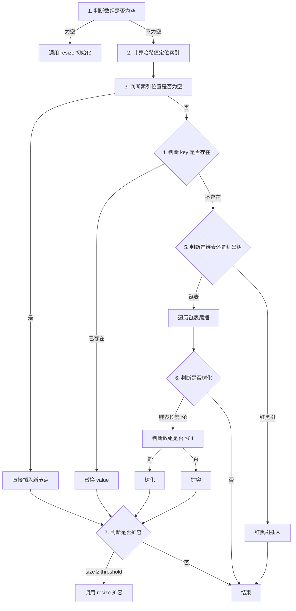

## 目录

- [一句话定位](#一句话定位)
- [一、HashMap 底层结构](#一hashmap-底层结构)
  - [JDK 1.7：数组 + 链表](#jdk-17数组--链表)
  - [JDK 1.8：数组 + 链表 + 红黑树](#jdk-18数组--链表--红黑树)
- [二、核心概念](#二核心概念)
  - [哈希函数](#哈希函数)
  - [负载因子（Load Factor）](#负载因子load-factor)
  - [树化阈值（TREEIFY_THRESHOLD）](#树化阈值treeify_threshold)
  - [扩容阈值（Threshold）](#扩容阈值threshold)
- [三、put 流程（JDK 1.8）](#三put-流程jdk-18)
  - [完整步骤](#完整步骤)
- [四、扩容机制（Resize）](#四扩容机制resize)
  - [什么时候扩容？](#什么时候扩容)
  - [扩容做了什么？](#扩容做了什么)
  - [JDK 1.7 vs 1.8 扩容对比](#jdk-17-vs-18-扩容对比)
- [五、面试高频问题](#五面试高频问题)
  - [Q1：为什么 HashMap 初始容量是 16？](#q1为什么-hashmap-初始容量是-16)
  - [Q2：为什么负载因子是 0.75？](#q2为什么负载因子是-075)
  - [Q3：为什么要转红黑树？什么时候转？](#q3为什么要转红黑树什么时候转)
  - [Q4：为什么链表转红黑树阈值是 8？](#q4为什么链表转红黑树阈值是-8)
- [引用](#引用)

---

# HashMap 底层原理与扩容

---

## 一句话定位

HashMap 是基于哈希表的 Map 实现，JDK 1.8 后采用「数组 + 链表 + 红黑树」结构，通过哈希函数定位数组索引，链表/红黑树解决哈希冲突，通过动态扩容保证性能。

## 一、HashMap 底层结构

### JDK 1.7：数组 + 链表
```
数组（Entry[]）
├─ [0] → Entry(key1,value1) → Entry(key2,value2) → null
├─ [1] → null
├─ [2] → Entry(key3,value3) → null
└─ ...
```
- 头插法：新节点插入链表头部
- 问题：并发扩容时会形成环形链表，导致死循环

### JDK 1.8：数组 + 链表 + 红黑树
```
数组（Node[]）
├─ [0] → Node → Node → (链表 < 8)
├─ [1] → TreeNode ←→ TreeNode ←→ TreeNode (红黑树 ≥ 8)
└─ ...
```
- 尾插法：新节点插入链表尾部
- 树化条件：链表长度 ≥ 8 且数组长度 ≥ 64
- 退化条件：红黑树节点 ≤ 6 时转回链表

## 二、核心概念

### 哈希函数

```java
// 1.8 的哈希函数：高16位异或低16位
static final int hash(Object key) {
    int h;
    return (key == null) ? 0 : (h = key.hashCode()) ^ (h >>> 16);
}

// 定位数组索引：hash & (length - 1)
// 要求 length 必须是 2 的幂，这样相当于取模运算
```
- 为什么异或高16位？
  - 哈希碰撞概率更低，让高位也参与索引计算

### 负载因子（Load Factor）

默认值：0.75

```java
static final float DEFAULT_LOAD_FACTOR = 0.75f;
```
- 作用：决定扩容时机
- 为什么 0.75？
  - 时间和空间的折中：太大哈希碰撞多，太小空间浪费多

### 树化阈值（TREEIFY_THRESHOLD）

```java
static final int TREEIFY_THRESHOLD = 8;  // 链表转红黑树
static final int UNTREEIFY_THRESHOLD = 6; // 红黑树转链表
static final int MIN_TREEIFY_CAPACITY = 64; // 最小树化数组容量
```

### 扩容阈值（Threshold）

```java
threshold = capacity * loadFactor;
```

## 三、put 流程（JDK 1.8）

### 完整步骤



## 四、扩容机制（Resize）

### 什么时候扩容？
1. 首次 put 时数组为空 → 初始化扩容到默认容量 16
2. size ≥ threshold（容量 * 负载因子）→ 扩容
3. 链表长度 ≥8 但数组长度 <64 → 先扩容代替树化

### 扩容做了什么？
- 新容量 = 旧容量 << 1（2倍）
- 重新计算每个节点在新数组中的索引位置
- 迁移节点

JDK 1.8 的优化：不用重新 hash，只用看原哈希的高一位

```
原容量 16  → 二进制 10000
新容量 32  → 二进制 100000

判断节点在新数组的索引：
原 hash & 16 == 0 → 索引不变
原 hash & 16 != 0 → 索引 = 旧索引 + 16
```

### JDK 1.7 vs 1.8 扩容对比

| 维度 | JDK 1.7 | JDK 1.8 |
|------|---------|---------|
| 插入方式 | 头插法 | 尾插法 |
| 扩容时计算索引 | 重新 hash | 看高一位 |
| 并发问题 | 死循环（环形链表） | 数据丢失/覆盖 |

## 五、面试高频问题

### Q1：为什么 HashMap 初始容量是 16？
- 必须是 2 的幂，保证 hash & (length-1) 等价于取模
- 16 是经验值：太小易扩容，太大浪费空间
- JDK 源码注释说 "16 seems to work well"

### Q2：为什么负载因子是 0.75？
- 时间和空间折中
- 0.75 是泊松分布计算出的结果：链表长度到8的概率只有亿分之六
- 太小频繁扩容，太大哈希碰撞多

### Q3：为什么要转红黑树？什么时候转？
- 链表查找是 O(n)，红黑树是 O(logn)
- 树化条件：
  1. 链表长度 ≥ 8
  2. 数组容量 ≥ 64（如果数组太小，优先扩容）

### Q4：为什么链表转红黑树阈值是 8？
- 泊松分布：在负载因子0.75下，链表长度到8的概率约为 0.00000006
- 8 是个足够小概率的阈值，不到万不得已不树化
- 树化有开销：红黑树节点占空间更大，插入删除更复杂

---

