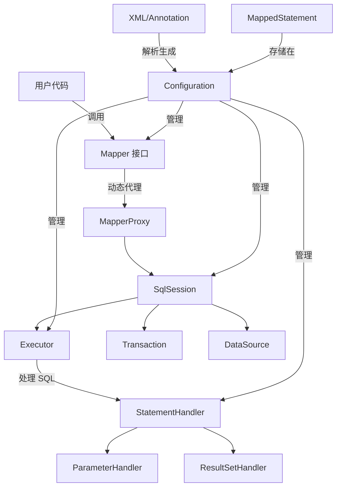
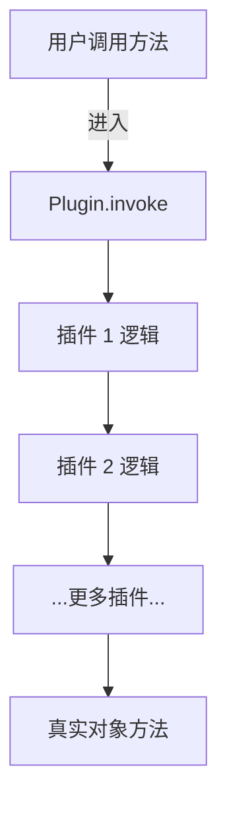

## 目录

- [一、一句话 MyBatis](#一一句话-mybais)
- [二、MyBatis 核心架构](#二mybatis-核心架构)
  - [核心组件图解](#核心组件图解)
  - [核心组件详解](#核心组件详解)
- [三、完整执行流程](#三完整执行流程)
  - [流程图](#流程图)
  - [详细步骤](#详细步骤)
- [四、动态代理实现原理](#四动态代理实现原理)
  - [getMapper 源码解析](#getmapper-源码解析)
  - [MapperProxy 源码解析](#mapperproxy-源码解析)
  - [完整示例](#完整示例)
- [五、SQL 执行流程](#五sql-执行流程)
  - [四大组件](#四大组件)
  - [Executor](#executor)
  - [StatementHandler](#statementhandler)
  - [ParameterHandler](#parameterhandler)
  - [ResultSetHandler](#resultsethandler)
- [六、缓存机制](#六缓存机制)
  - [一级缓存](#一级缓存)
  - [二级缓存](#二级缓存)
  - [对比表](#对比表)
- [七、插件机制](#七插件机制)
  - [四大可拦截对象](#四大可拦截对象)
  - [@Intercepts 和 @Signature 注解](#@intercepts-和-@signature-注解)
  - [插件实现示例](#插件实现示例)
  - [执行链原理](#执行链原理)
- [八、面试高频问题](#八面试高频问题)

---

# MyBatis 原理

---

## 一、一句话 MyBatis

> MyBatis 是一个优秀的 **持久层框架**，它支持定制化 SQL、存储过程以及高级映射，**避免了几乎所有的 JDBC 代码和手动设置参数以及获取结果集**。可以使用简单的 XML 或注解来配置和映射原始类型、接口和 Java POJO 为数据库中的记录。

简单说：**是对 JDBC 的封装，XML/注解写 SQL，动态代理调用，自动映射结果。**

---

## 二、MyBatis 核心架构

### 核心组件图解



### 核心组件详解

| 组件 | 说明 |
|------|------|
| **Configuration** | 全局配置对象，包含所有配置信息、SQL 映射、缓存配置等 |
| **SqlSession** | 代表一次数据库会话，提供 CURD 操作 |
| **Executor** | 真正执行 SQL 的核心调度器，负责维护一级/二级缓存 |
| **StatementHandler** | 负责 JDBC Statement 的创建、参数设置、执行等 |
| **ParameterHandler** | 负责设置 SQL 参数，处理 #{ } 和 ${ } |
| **ResultSetHandler** | 负责 ResultSet 结果映射，处理结果集到对象的映射 |
| **TypeHandler** | 类型处理器，负责 Java 和 JDBC 类型之间的转换 |
| **MappedStatement** | 存储一条 SQL 的完整信息（id、SQL、入参出参类型等） |
| **MapperProxy** | Mapper 接口的动态代理对象，拦截接口方法调用 |
| **Transaction** | 事务控制对象（JDBC 或 Spring 管理） |

---

## 三、完整执行流程

### 流程图

```mermaid
flowchart LR
    Start["1. 读取配置
    mybatis-config.xml
    + 所有 Mapper XML"] --> Init["2. 构建 Configuration对象
    包含 MappedStatement"]
    Init --> GetSession["3. 打开 SqlSession
    sqlSessionFactory.openSession()"]
    GetSession --> GetMapper["4. 获取 Mapper代理
    getMapper(UserMapper.class)"]
    GetMapper --> Invoke["5. 调用接口方法
    userMapper.selectById(1)"]
    Invoke --> Intercept["6. MapperProxy.invoke
    拦截方法调用"]
    Intercept --> Executor["7. Executor 执行
    执行 query/update"]
    Executor --> StatementHandler["8. StatementHandler创建"]
    StatementHandler --> ParameterHandler["9. 设置参数
    ParameterHandler"]
    ParameterHandler --> Statement["10. 执行 SQL
    executeUpdate/executeQuery"]
    Statement --> ResultSetHandler["11. 映射结果
    ResultSetHandler"]
    ResultSetHandler --> Return["12. 返回结果"]
```



### 详细步骤

#### 第 1-2 步：初始化阶段

```java
// 1. 读取配置文件
InputStream inputStream = Resources.getResourceAsStream("mybatis-config.xml");

// 2. 构建 SqlSessionFactory
SqlSessionFactory sqlSessionFactory = 
    new SqlSessionFactoryBuilder().build(inputStream);
```

构建过程中：
- XMLConfigBuilder 解析全局配置
- XMLMapperBuilder 解析每个 Mapper XML
- 生成 `MappedStatement` 存入 `Configuration`

#### 第 3-4 步：开启会话，获取 Mapper

```java
// 3. 打开 SqlSession
SqlSession sqlSession = sqlSessionFactory.openSession();

// 4. 获取 Mapper 代理对象
UserMapper userMapper = sqlSession.getMapper(UserMapper.class);
```

#### 第 5-12 步：执行 SQL

```java
// 5. 调用接口方法（实际是代理调用）
User user = userMapper.selectById(1L);

// 6. 关闭会话
sqlSession.close();
```

---

## 四、动态代理实现原理

MyBatis 使用 **JDK 动态代理** 为 Mapper 接口生成代理对象。

### getMapper 源码解析

核心代码：
```java
// Configuration.java
public <T> T getMapper(Class<T> type, SqlSession sqlSession) {
    MapperProxyFactory<T> mapperProxyFactory = 
        (MapperProxyFactory<T>) knownMappers.get(type);
    return mapperProxyFactory.newInstance(sqlSession);
}

// MapperProxyFactory.java
public T newInstance(SqlSession sqlSession) {
    MapperProxy<T> mapperProxy = new MapperProxy<>(
        sqlSession, mapperInterface, methodCache
    );
    return (T) Proxy.newProxyInstance(
        mapperInterface.getClassLoader(),
        new Class[]{mapperInterface},
        mapperProxy
    );
}
```

### MapperProxy 源码解析

```java
public class MapperProxy<T> implements InvocationHandler, Serializable {

    private final SqlSession sqlSession;
    private final Class<T> mapperInterface;
    private final Map<Method, MapperMethodInvoker> methodCache;

    @Override
    public Object invoke(Object proxy, Method method, Object[] args) throws Throwable {
        // 判断是否是 Object 本身的方法（equals、hashCode、toString）
        if (Object.class.equals(method.getDeclaringClass())) {
            return method.invoke(this, args);
        }
        // 获取或缓存方法调用器，执行
        return cachedInvoker(method).invoke(proxy, method, args, sqlSession);
    }
}
```

### 完整示例

```java
// 1. Mapper 接口
public interface UserMapper {
    User selectById(Long id);
    List<User> selectAll();
}

// 2. Mapper XML
<select id="selectById" resultType="User">
    SELECT * FROM user WHERE id = #{id}
</select>

// 3. 实际调用
UserMapper mapper = sqlSession.getMapper(UserMapper.class);
User user = mapper.selectById(1L);  // 动态代理调用！

// 4. 实际上相当于：
MappedStatement ms = configuration.getMappedStatement("com.example.mapper.UserMapper.selectById");
return sqlSession.selectOne(ms, 1L);
```

---

## 五、SQL 执行流程

### 四大组件

| 组件 | 作用 | 可拦截的方法 |
|------|------|------------|
| Executor | SQL 执行器，负责调用 StatementHandler | update、query、commit、rollback |
| StatementHandler | 处理 JDBC Statement 生命周期 | prepare、parameterize、batch、update、query |
| ParameterHandler | 处理 SQL 参数 | getParameterObject、setParameters |
| ResultSetHandler | 处理结果映射 | handleResultSets、handleOutputParameters |

### Executor

Executor 是 SQL 执行器，有三种实现：

| 实现类 | 特点 |
|--------|------|
| **SimpleExecutor** | 每次执行 SQL 都会创建新的 Statement |
| **ReuseExecutor** | 复用 Statement 对象（以 SQL 为 key） |
| **BatchExecutor** | 批量执行 SQL，用于批量操作 |

执行流程：
```java
// SimpleExecutor.doQuery()
public <E> List<E> doQuery(MappedStatement ms, Object parameter, RowBounds rowBounds, ResultHandler resultHandler, BoundSql boundSql) {
    // 1. 获取 Connection
    // 2. 创建 StatementHandler
    StatementHandler handler = configuration.newStatementHandler(wrapper, ms, parameter, rowBounds, resultHandler, boundSql);
    
    // 3. 准备 Statement（设置超时等）
    Statement stmt = prepareStatement(handler);
    
    // 4. 查询
    return handler.query(stmt, resultHandler);
}
```

### StatementHandler

负责 JDBC Statement 的创建和执行。

核心流程：
1. `prepare()` - 预编译 SQL
2. `parameterize()` - 设置参数（调用 ParameterHandler）
3. `update()` 或 `query()` - 执行 SQL

### ParameterHandler

处理 SQL 参数设置，类型转换通过 TypeHandler。

```java
public interface ParameterHandler {
    // 获取参数对象
    Object getParameterObject();
    
    // 设置 PreparedStatement 的参数
    void setParameters(PreparedStatement ps) throws SQLException;
}
```

**`#{ }` vs `${ }` 区别：**
- `#{ }` - 预编译处理，参数替换，防止 SQL 注入
- `${ }` - 字符串直接替换，有 SQL 注入风险

### ResultSetHandler

处理 ResultSet 到 Java 对象的映射。

```java
public interface ResultSetHandler {
    // 处理结果集
    <E> List<E> handleResultSets(Statement stmt) throws SQLException;
    
    // 处理存储过程 OUT 参数
    void handleOutputParameters(CallableStatement cs) throws SQLException;
}
```

---

## 六、缓存机制

### 一级缓存

**又称本地缓存、SqlSession 级别缓存**

| 特性 | 说明 |
|------|------|
| 作用域 | SqlSession 级别，默认开启，不可关闭 |
| 实现 | PerpetualCache，底层是 HashMap |
| 生效条件 | 同 SqlSession、同 MappedStatement、同参数 |
| 清空时机 | update/insert/delete、commit、close |

**示例：**
```java
SqlSession sqlSession1 = factory.openSession();
UserMapper mapper1 = sqlSession1.getMapper(UserMapper.class);

// 第一次查询，实际查询数据库，缓存写入
User user1 = mapper1.selectById(1L);

// 第二次查询，从缓存获取，不查询数据库
User user2 = mapper1.selectById(1L);
// user1 == user2

// 执行 update，缓存清空
mapper1.updateUser(user1);

// 再次查询，又查询数据库
User user3 = mapper1.selectById(1L);
```

### 二级缓存

**又称全局缓存、namespace 级别缓存**

| 特性 | 说明 |
|------|------|
| 作用域 | namespace/Mapper 级别，默认不开启 |
| 实现 | 可自定义，默认也是 PerpetualCache |
| 开启方式 | mybatis-config.xml 开启 + Mapper XML 添加 `<cache/>` 标签 |
| 生效条件 | 同 Mapper、同查询方法、同参数 |
| 清空时机 | 同一 namespace 执行 update/insert/delete |
| 执行流程 | 先查二级缓存 → 再查一级缓存 → 最后查数据库 |

**开启示例：**
```xml
<!-- mybatis-config.xml -->
<settings>
    <setting name="cacheEnabled" value="true"/>
</settings>

<!-- UserMapper.xml -->
<mapper namespace="com.example.UserMapper">
    <cache type="org.apache.ibatis.cache.impl.PerpetualCache"
           size="1024"
           eviction="LRU"
           flushInterval="60000"
           readOnly="false"/>
</mapper>
```

### 对比表

| 特性 | 一级缓存 | 二级缓存 |
|------|---------|---------|
| **默认开启** | ✅ | ❌ |
| **作用域** | SqlSession | Namespace/Mapper |
| **实现类** | PerpetualCache | 可配置 |
| **清理时机** | commit/close/任意更新 | 同一 namespace 更新 |
| **优先级** | 低 | 高（先查二级） |

---

## 七、插件机制

### 四大可拦截对象

插件可以拦截的四个核心对象的指定方法：

| 可拦截对象 | 可拦截的方法 |
|-----------|-------------|
| Executor | update、query、commit、rollback、getTransaction、close、isClosed |
| StatementHandler | prepare、parameterize、batch、update、query |
| ParameterHandler | getParameterObject、setParameters |
| ResultSetHandler | handleResultSets、handleOutputParameters |

### @Intercepts 和 @Signature 注解

```java
@Intercepts({
    @Signature(
        type = Executor.class,
        method = "update",
        args = {MappedStatement.class, Object.class}
    ),
    @Signature(
        type = StatementHandler.class,
        method = "prepare",
        args = {Connection.class, Integer.class}
    )
})
public class MyPlugin implements Interceptor {
    @Override
    public Object intercept(Invocation invocation) throws Throwable {
        // 自定义逻辑
        Object target = invocation.getTarget();
        Method method = invocation.getMethod();
        Object[] args = invocation.getArgs();
        
        // 执行原方法
        Object result = invocation.proceed();
        
        return result;
    }
}
```

### 插件实现示例

**需求：打印每次执行 SQL 的耗时**

```java
@Intercepts({
    @Signature(
        type = Executor.class,
        method = "update",
        args = {MappedStatement.class, Object.class}
    ),
    @Signature(
        type = Executor.class,
        method = "query",
        args = {MappedStatement.class, Object.class, RowBounds.class, ResultHandler.class}
    )
})
public class SqlCostInterceptor implements Interceptor {

    @Override
    public Object intercept(Invocation invocation) throws Throwable {
        long startTime = System.currentTimeMillis();
        
        try {
            return invocation.proceed();  // 执行 SQL
        } finally {
            long endTime = System.currentTimeMillis();
            System.out.println("SQL 执行耗时: " + (endTime - startTime) + "ms");
        }
    }
}
```

**注册插件：**
```xml
<!-- mybatis-config.xml -->
<plugins>
    <plugin interceptor="com.example.SqlCostInterceptor"/>
</plugins>
```

### 执行链原理

使用 **责任链模式 + JDK 动态代理** 实现：



源码关键类 `Plugin`：
```java
public class Plugin implements InvocationHandler {
    public Object invoke(Object proxy, Method method, Object[] args) throws Throwable {
        // 判断方法是否被拦截
        Set<Method> methods = signatureMap.get(method.getDeclaringClass());
        if (methods != null && methods.contains(method)) {
            // 执行拦截
            return interceptor.intercept(new Invocation(target, method, args));
        }
        // 不拦截，直接执行
        return method.invoke(target, args);
    }
}
```

---

## 八、面试高频问题

### 1. 什么是 MyBatis？有哪些核心组件？

见上面「二、MyBatis 核心架构」

### 2. MyBatis 中 Mapper 接口的工作原理是什么？

- 使用 JDK 动态代理生成 MapperProxy 对象
- 调用时通过 MappedStatement 匹配 SQL
- 调用 SqlSession 执行实际数据库操作

### 3. MyBatis 一级、二级缓存区别？

见上面「六、缓存机制 - 对比表」

### 4. MyBatis 插件的实现原理？

- 使用责任链 + 动态代理
- 四大可拦截对象：Executor、StatementHandler、ParameterHandler、ResultSetHandler
- @Intercepts + @Signature 声明拦截点
- 实现 Interceptor 接口

### 5. #{} 和 ${} 区别？

| 特性 | #{ } | ${ } |
|------|------|------|
| **处理方式** | 预编译参数替换 | 字符串直接替换 |
| **SQL注入** | ❌ 安全 | ✅ 有风险 |
| **使用场景** | 所有参数值 | 表名、列名等 |

### 6. MyBatis 执行流程？

见上面「三、完整执行流程」

---
